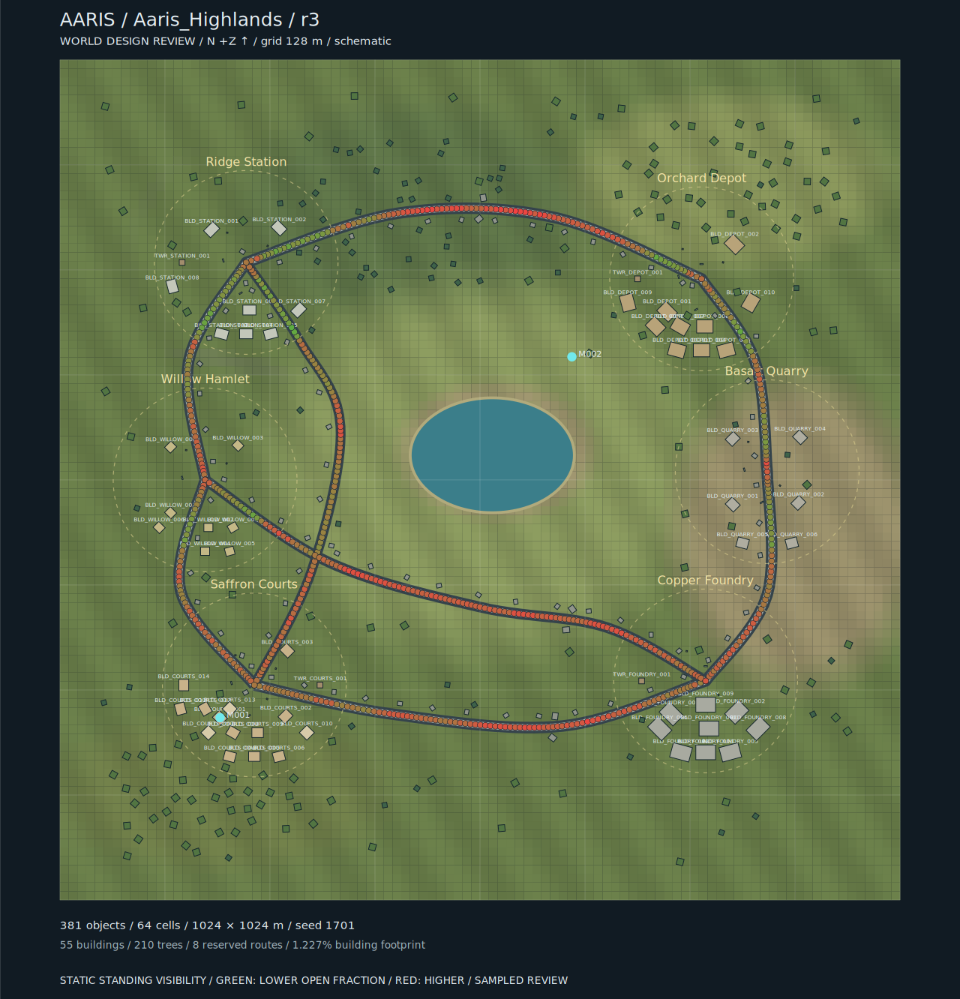
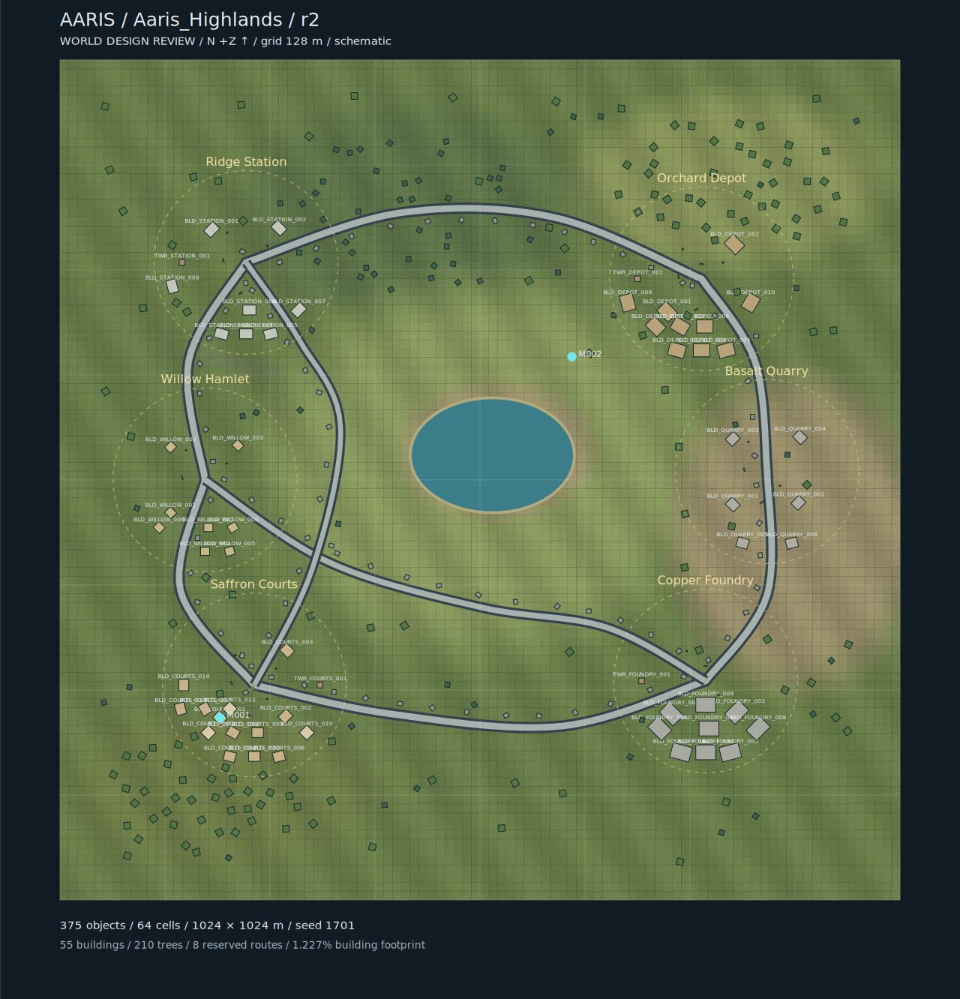
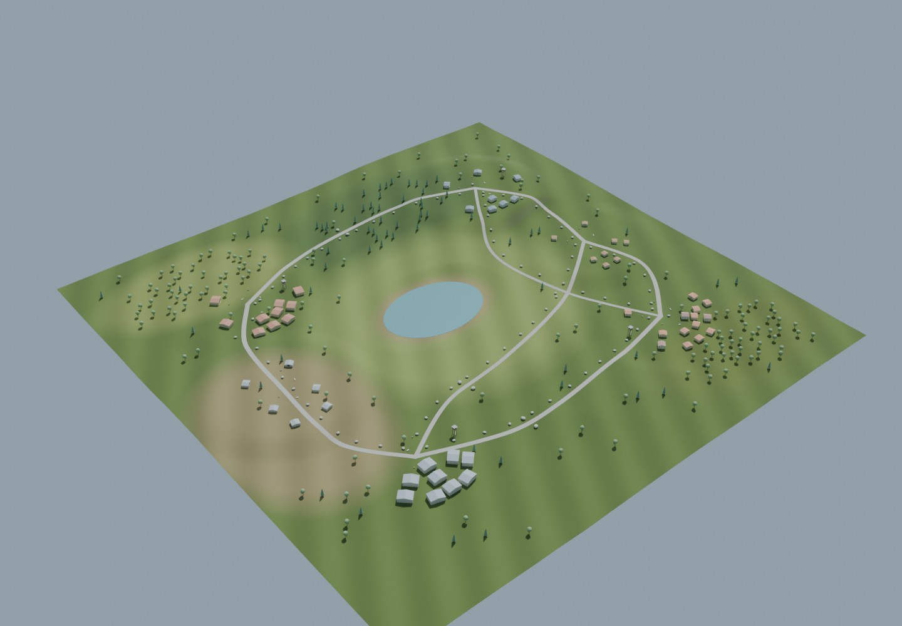
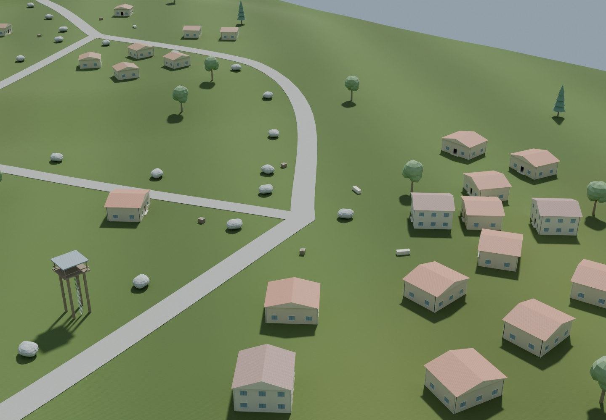

# Aaris Highlands — world authoring and native physics sandbox

Original Unity **6000.3.26f1** / C# / URP **17.3.0** mobile-world authoring. Map edits, review rendering and Android player builds remain separate.

**हर map edit पर APK नहीं बनेगा।** Source data और C# बदलते हैं; checks और previews अलग चलते हैं। Automatic Android player build इस repository में नहीं है।

## Collision and map audit

Six natural cover rocks reduce the longest flagged standing-visibility run from 215 m to 78 m in our static sampling review. The BVH uses actual source collision triangles; this is a diagnostic, not proven combat balance. Roof underside collision, stale/lost input, backward shooting and camera overlap handling are improved. [Audit and evidence](Docs/AUDIT.md).



## Local gameplay / physics milestone

Native Unity C# now includes a Rigidbody capsule motor, gravity/collision settings, jump/sprint, stable multitouch joystick/swipe controls, camera obstruction, a local hitscan rifle, reload/damage targets and six physical box props. `PhysicsSandboxCompiler` assembles a separate sandbox from the existing map.

**Engine/device acceptance is pending.** The previous 107 .NET tests validated policies/source, not native physics; four additional wind tests have been authored but not run in this environment. Twenty-one Unity integration tests are authored but have not run here. Current character/gun/HUD are development harnesses. Sandbox revision 2 adds a moving/shrinking battle-zone practice loop, outside damage, a boundary and HUD timing; it is not multiplayer. [Gameplay details and remaining gaps](Docs/GAMEPLAY.md).

## Current world

**Revision 4 visual authoring:** optional canopy-only breeze on original oak/pine prefabs. Each tree has three LOD canopy pivots with distinct position-seeded motion; trunks and static collision never move. Wind is render-only, local to each device, and needs no network packet stream. The review screenshots below were generated before this change and do **not** show animated leaves. Android optimized frame pacing is enabled when authoring the Unity project; sustained phone FPS is not yet measured.


| Feature | Revision 4 |
| --- | --- |
| Terrain | 1024 × 1024 m, 64 cells, 4 m mesh spacing, hills and lake |
| Settlements | 6 districts, 55 buildings and 4 lookout towers |
| Environment | 210 trees, 88 boulders and 24 cover props; 381 placements total |
| Traversal | 8 reserved routes, 2–3 distinct neighbours per district, redundant route graph |
| Density | At most 9 building anchors in a cell; building footprints occupy 1.23% of the world |
| Art | 13 original procedural development asset types, shared meshes/materials, 3 LODs |



## 3D geometry reviews

These images render the **same C# geometry and material data** in Blender 4.2 CPU Cycles. They are offline art/layout reviews, **not Unity frames or proof of mobile performance**. The art is stylized development art; final production art and device validation remain separate work.




[Ridge Station review](Docs/Review/ridge-perspective.jpg) · [Terrain-aware route proposal](Docs/Review/route-proposal.png) · [Authoring metrics](Docs/Review/metrics.json) · [Research and design decisions](Docs/RESEARCH.md)

## Checks and rendering

Stable IDs and revision guards protect edits. Validation checks rotated footprints, slope/relief, roads and water. Design rules constrain district populations, building/canopy density, countryside construction, route connectivity and walking corridors. Cover metrics sample **distance to nearby authored cover**, not line-of-sight protection or proven combat balance.

The Unity compiler generates shared native meshes, PBR material/normal textures, window/door geometry, three LODs, fixed collision meshes, biome-tinted terrain, merged road junctions, sky, sun and fog. Actual shader compilation/Unity behaviour require a licensed Unity runner. The generated review scene is fully loaded; runtime streaming/Addressables and HLOD are not implemented yet.

## Commands

With .NET 8, from the repository root:

```bash
dotnet run --project Tools/WorldTool -- self-test
dotnet run --project Tools/WorldTool -- validate
dotnet run --project Tools/WorldTool -- validate-sandbox
dotnet run --project Tools/WorldTool -- review-visibility
dotnet run --project Tools/WorldTool -- review
dotnet run --project Tools/WorldTool -- move Tools/Commands/move-example.json
dotnet run --project Tools/WorldTool -- plan-route Tools/Commands/route-example.json
```

The route command writes a fingerprinted JSON/SVG proposal under `Review/route/`, avoiding water, conservative object footprints and sampled steep slopes. It never rewrites the world. Review a route before promoting it; this is not runtime navigation.

The move example is a dry run. `--apply` writes a validated edit and increments the revision. Update subsequent commands to the current revision. `world.json` and `assets.json` are editable source; generated Unity files are disposable.

Export exact procedural geometry for offline inspection:

```bash
dotnet run --project Tools/WorldTool -- export-geometry
blender -b --factory-startup -t 8 --python Tools/render_geometry.py -- \
  --scene Review/geometry/scene.json --output Review/offline --samples 24
```

The one-time `prepare-highlands-v2` command generated a reviewed proposal from r1. It refuses to regenerate r2 or overwrite later hand edits. It is never invoked automatically.

For a licensed Unity editor:

```bash
export UNITY_EDITOR=/path/to/Unity
bash Tools/unity-review.sh compile
bash Tools/unity-review.sh sandbox
bash Tools/unity-review.sh test
xvfb-run -a bash Tools/unity-review.sh render
```

These authoring commands do not build an APK. See [architecture](Docs/ARCHITECTURE.md), [validation status](Docs/STATUS.md) and [asset contract](Docs/ASSETS.md).
