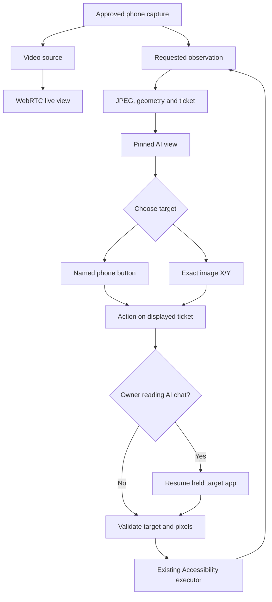

# AI link: full phone image, decision ticket and tap mapping

Version: 1.9.60 (148). Baseline: 83b638aff2be158282a91ae051d85102ffc52def.
Scope: Connect with AI through link; existing phone-to-phone video is unchanged.

## Dependency and state map

| Stage | Source / owner | Result and downstream effect |
| --- | --- | --- |
| Consent | MainActivity → BrowserLinkBackend → ScreenShareService | Existing whole-display consent and foreground sharing service. No second projection. |
| Pixels | ScreenCaptureTrack → AiSnapshotProvider | A requested independent CPU frame from the existing projection. |
| Observation | AiObservationEngine → AiScreenLedger | Upright full-display JPEG, geometry, UI hints and a single-use 90-second ticket. Privacy and changed-window checks remain active. |
| Bridge | HostWebRtcSession → BrowserAgentBridge | Same control lease, projection and Accessibility executor as the live link. Publishes an authenticated observation to the session Worker. |
| Initial image | AarisSession → agentPage | JPEG embedded with the matching observation id. Rendering an existing decision page does not start a capture that invalidates its ticket. |
| Decision | browserMain AI view | The complete image stays pinned. A new action result or explicit Fresh screenshot replaces it. Browser controls expire conservatively at 85 seconds, accounting for server receive age. |
| Target | semanticTargets / browser-protocol point | Named DOM buttons or exact normalized X/Y. Letterbox margins are excluded. Labeled children inside bounded clickable parents use their own label centers. |
| Admission | browserMain agentAct → AarisSession agentEnqueue/agentStart | Browser claim, controller epoch, action id, nonce and one in-flight operation. No automatic action replay. |
| Same-phone chat | BrowserAgentCommand.requiresTargetResume → BrowserAgentBridge | A tap on a held target returns from a supported AI chat to the recorded app. Home/open_app are independent. Ordinary unrelated apps are not silently resumed. |
| Validation | AiObservationEngine.validate | Restored app/window, display geometry, target and fresh pixels are checked before the existing dispatch deadline. Changed scenes are refused. |
| Execution | AiActionTranslator → AssistAccessibilityService | Normalized full-display coordinates become Android input. STOP, lease, privacy and final dispatch checks remain enforced. |
| Result | BrowserAgentBridge.finish → agentPublish → browserMain | Execution outcome and replacement image. Applied describes input execution, not successful completion of the user's semantic goal. |

## Defects corrected at their source

1. **Same-phone foreground mismatch.** The bridge retained a target image while
   the owner read ChatGPT, but only the text-response adapter resumed that target.
   Browser HTTPS taps could fail FOREGROUND_CHANGED while Home worked. Both
   callers now use the same foreground-aware, pixel-validated resume path.
2. **Decision coordinates reticketed at execution.** AI Command JSON previously
   fetched a newer observation before applying a coordinate chosen from the old
   visible image. It now uses exactly the displayed ticket. A scene change returns
   a refusal and a replacement observation, requiring a new decision.
3. **Image/ticket race.** Server HTML and a later JPEG request could refer to an
   observation that another capture had already replaced. The initial bytes and
   observation id are embedded together; rendering an existing page no longer
   queues a replacement capture. Later image loads enable input only after the
   matching image has loaded.
4. **DOM-only AI had navigation buttons but no phone targets.** UI hints were
   text only. Observed actionable targets are now buttons; arbitrary positions
   use visible X/Y controls or JSON. Raw images opened separately are explicitly
   read-only rather than appearing to be another control surface.

## Expected user flow

1. Approve whole-screen sharing on the phone and open its complete link.
2. Inspect the full phone image in AI view. Read its geometry/status. A protected
   or missing image is not evidence from which to guess a coordinate.
3. Click a Tap phone button or set normalized X/Y and press Tap point. A browser
   supporting image-coordinate clicks can click inside the primary phone image.
4. Wait for the result; inspect the replacement image before choosing again.
5. Use Live view for continuous video and gestures. Return to AI view for a
   stable screenshot-backed decision. Fresh screenshot explicitly re-observes.

## Verification

- Worker regressions cover inline image identity, read-only page admission,
  image download, claim replacement, action deduplication and STOP revocation.
- Browser screenshot integration covers image display, exact pointer mapping,
  letterbox rejection, named-child target centers, pixel-space JSON, pinned
  decisions, stale-scene refusal, mismatched geometry and explicit refresh.
- Browser RTP/SCTP integration selects Live view and checks its existing gesture
  and telemetry pipeline, then selects AI view for observation-backed JSON input.
- Android tests exercise a held target → ChatGPT → restored target transition,
  exact coordinates, changed restored pixels, changed foreground after validation
  and independent Home/app launch. Full tests/lint/APK assembly are delivery gates.
- `python3 tools/ai_link_test_phone.py --state-file /tmp/aaris-test-session.json`
  connects disposable synthetic JPEGs and actions to the deployed website for
  browser inspection. It revokes its own session on exit. It never connects a real
  phone, launches a real app or proves physical Android capture/gesture behavior.

The supplied recording has a black main application area for about the first
70 seconds and visible WhatsApp around 72 seconds. It does not identify the
foreground package, capture error or installed build. Protected-window capture
and vendor Accessibility behavior still need a physical-device run. These fixes
do not bypass secure-window capture or make every AI client capable of browsing.
