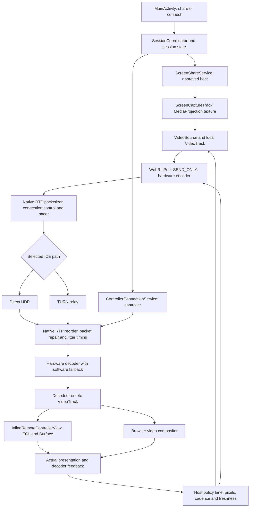
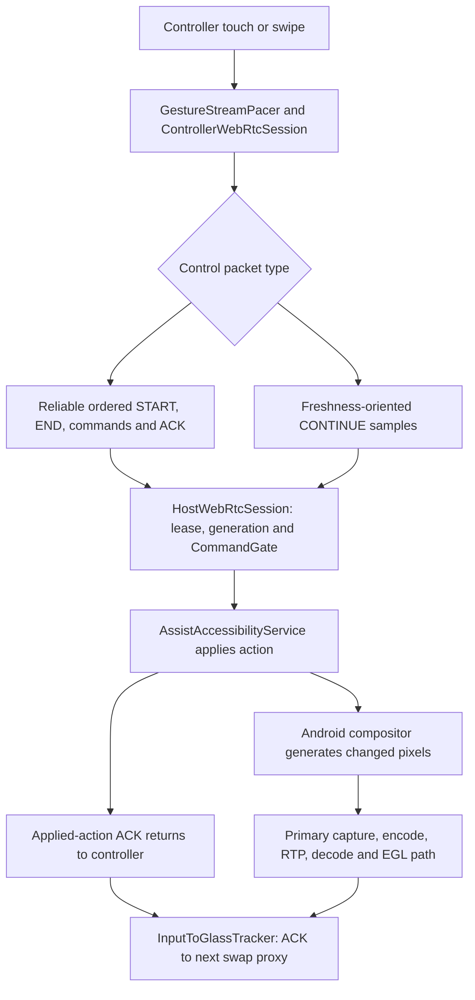

# Aaris Remote: frame flow, stutter audit and corrections

Audited source: `warishakhan3548-hash/updating-repository`, main `8222234f7cc263bc341a9fe0ba599a819dc21b60` (1.9.61).
SDK: `io.github.webrtc-sdk:android:150.7871.01`.
Scope: phone-to-phone primary video, its adaptation feedback, and shared browser compatibility. This report distinguishes verified code defects from recording observations and unmeasured device hypotheses.

## The complete dependency map



| Stage | Concrete source and execution | What can stall here; downstream effect |
| --- | --- | --- |
| Consent and lifetime | `MainActivity` / `SessionCoordinator` → `ScreenShareService` and `ControllerConnectionService` | A missing grant, stopped service or stale session is a lifetime failure; tuning bitrate cannot repair it. |
| Pixel production | `ScreenCaptureTrack.start` → `ScreenCapturerAndroid` → one MediaProjection virtual display → `SurfaceTextureHelper` | Android can supply sparse updates on a still screen. Holding its texture or blocking its callback delays subsequent genuine frames. |
| Capture handoff | `ScreenCaptureTrack.onFrameCaptured` → `videoSource.capturerObserver.onFrameCaptured` → `VideoTrack` | Natural frames enter the main video path before optional snapshot sinks. `CaptureActivityTracker` measures original producer timestamps; forced repeats do not count as new screen motion. |
| Capture policy | `ScreenCaptureTrack.adaptOutput` → `VideoSource.adaptOutputFormat` | Caps source pixels/FPS. Routine policy changes preserve the virtual display; actual display-shape changes alone call `changeCaptureFormat`. |
| Encoding | `WebRtcRuntime` factories → `WebRtcPeer.addLocalVideoTrack` SEND_ONLY transceiver | Negotiated hardware baseline H.264/VP8 is preferred, with software fallback. Encoder cost is measured per **encoded** frame. Large dimension changes may reconfigure a vendor codec. |
| Transmission | `WebRtcPeer.applyInteractiveVideoPolicy` → RTP sender → native GCC/TWCC, packet pacing, SRTP | Configured bitrate/FPS are ceilings. Encoded frames are not proof that their packets have left the sender. The pinned SDK aliases its sent-frame counter to encoding; sender residence and receiver decode/display evidence must remain separate from encoder count. |
| Connectivity | `CloudflareSignalingClient` + `IceServerProvider` → selected direct UDP / TURN route | SDP/ICE establishes the path. Normal video is RTP, rather than repeated Worker screenshot uploads. Packet propagation, loss and recovery constrain deadlines. |
| Assembly and decode | Native receiver reorder/NACK/jitter timing → decoder → `WebRtcPeer.onTrack` / `onAddTrack` → `ControllerWebRtcSession` | Missing dependent packets can prevent a whole frame from decoding. Decoder cost and emitted-buffer residence expose different bottlenecks. |
| Android display | `InlineRemoteControllerView.renderSink` → `EglRenderer.onFrame` → EGL swap → Surface/compositor | Latest pending frames replace obsolete pending work. Actual render callbacks feed `PresentationCadenceTracker`; decoded count alone does not establish visible smoothness. |
| Browser display | `browser-console.js` → HTML video / `requestVideoFrameCallback`; `receiver-playout.js` | Uses native video playback and a supported adaptive jitter target. A hidden/stalled compositor or unsupported callback must not manufacture display FPS. |
| Adaptation | `VideoHealthSnapshot.from` → `VideoHealthWindowTracker.sample` → `HostWebRtcSession.onVideoHealth` → `ReceiverVideoFeedback`, `MotionVideoBudget`, `VideoCadenceGovernor`, `HighCadenceProbe`, `PhotonFreshnessGovernor` | Scalar evidence determines ceilings. Incorrect demand accounting, zero-supply classification or recovery admission can cause unnecessary reductions or an unsafe recovery upshift. |
| Compatibility pixels | The same capture → `FallbackScreenStreamer` / `AiSnapshotProvider` → owned CPU copy → bounded worker | Separate recovery/AI work, rather than the normal video stream. Retaining a producer texture or allowing old JPEG work to accumulate would harm primary capture. |

## UI and state map

The local UI state sequence is `IDLE → READY → CODE_ACTIVE → PAIR_PENDING → HOST_APPROVED → SCREEN_CONSENT → CONNECTING → LIVE → CLOSED`.
The backend sequence is `CODE_ACTIVE → PAIR_PENDING → HOST_APPROVED → SCREEN_READY → LIVE → CLOSED`.

A host approves sharing and Android grants MediaProjection. `ScreenShareService` owns the foreground capture lifetime. The controller connection service prewarms signaling/ICE after approval and owns the peer independently of Activity navigation. Once the remote track exists, the inline viewer attaches its sink. A real EGL swap confirms presentation; simply connecting a peer or receiving a track does not.



The ACK-to-next-swap measurement is a proxy. A buffered picture can predate the applied action, so it is not a causal input-to-photon guarantee. Input and ACKs do not wait in an application-created video reservoir.

## Recordings inspected

All three supplied recordings were materialized, visually sampled across their duration and scanned end-to-end at 2 Hz. Diagnostic text was additionally read from multiple full-resolution frames of the trace recording. This analyzes the recordings; it does not measure the live RTP stream or prove a root cause from every dark frame.

| Recording | Duration | Directly observable evidence | Interpretation limits |
| --- | --- | --- | --- |
| `1000043400.mp4` | 62.85 s | A moving WhatsApp overlay and a host connection trace. Samples show a persistent 15-FPS target, a temporary 24-FPS rescue followed by 20/15, source cadence varying from sparse to roughly 25–27 FPS, decoded samples around 1–5 FPS or absent, and frequently zero measured sender residence. Hardware implementation is `c2.mtk.avc.encoder`; shown lifetime encode average is around 25 ms, with interval cost varying. | This is not proof that packet loss explains every freeze. Controller presentation windows are often absent. Encoder average is not full encode-to-display latency. Phone/codec/network constraints and missing feedback must be separated. |
| `1000043438.mp4` | 86.26 s | Extended dark screen content with the STOP overlay, a visible recent-apps transition, and visible WhatsApp content near the end. | The recording alone does not identify whether the dark content originated in the source, decoder, compositor, app window or another state. Current main already includes first-frame decoder and stale-EGL fixes; this change does not claim to replace those fixes. |
| `1000043462.mp4` | 144.05 s | AI/browser inspection remains at “Connecting live video” and later reports an observation-expiry condition. | This is a browser connection/observation symptom as well as a video symptom. It is not a measurement of a healthy Android decoder displaying at low FPS. |

Personal Context retrieval was attempted as requested; conversation retrieval returned an error. Current repository history, existing audit documents and the actual supplied recordings grounded this audit instead. No older source snapshot was restored over current main.

## Verified defects and surgical changes

### 1. Recovery admitted one resolution but installed a larger one

`MotionVideoBudget.observe` calculated `nextRecoveryRung = 240` when recovering from 180 pixels. Its bandwidth test approved 240, but its actuator assignment selected 360 for any current rung below 360.

At 30 FPS, a 700-kbps estimate clears 240's 500-kbps nominal demand plus the 20% recovery margin. It does not clear 360's 900-kbps demand plus that margin. The old jump could immediately exceed the admitted workload and re-enter the congestion/downshift cycle.

The original assignment now sets `shortEdge = nextRecoveryRung`. The expensive encoder-resolution actuator and the admission check use the same value. Subsequent recovery to 360 still needs its own healthy evidence and bandwidth margin.

### 2. A requested FPS ceiling was mistaken for offered traffic

The predictive bandwidth model previously priced every moving source at `targetFps`, even when original capture consistently supplied fewer frames and the sender was keeping up with that supply. The prior 1-FPS starvation fix prevented some false reductions, but a regular 15-FPS source on a 60-FPS ceiling still paid for 60-FPS traffic.

The predictive demand now uses measured source supply, capped by the requested goal. For 360-wide frames, 15 actual FPS on a 60-FPS ceiling changes the first-order demand estimate from 1.8 Mbps to 450 kbps. The source FPS cap and bitrate actuator remain at the requested goal, so new faster motion can still use that capacity. Recovery admission continues budgeting the full requested cadence. Real codec, pacer, receiver and loss pressure still receive relief.

This remains an approximate early predictor, not a replacement for WebRTC's congestion controller or a promise of exact bits per frame.

### 3. Known zero media supply manufactured presentation pressure

`PhotonFreshnessGovernor.observe` built the expected glass cadence from requested, encoded and decoded FPS, then removed every zero value. With a 60-FPS ceiling, encoded=0, decoded=0 and presented=0, that discarded both measured supply counters and compared the empty display window against 60 FPS. The resulting zero delivery ratio falsely classified a quiet stream as presentation pressure.

Known zero supply now remains in the minimum. With no upstream supply, the delivery ratio is unavailable and the window is `UNKNOWN`; it cannot invent display pressure or clean delivery proof. Genuine queue, jitter, presentation-age and ACK pressure remain independent. A separate regression checks that a 350-ms sender queue still classifies as `PRESSURE` even with zero media supply.

### SDK counter limitation and the diagnostic correction

The exact pinned SDK source was retrieved and inspected, including `media/engine/webrtc_video_engine.cc` and `pc/rtc_stats_collector.cc`. In this version, `info.frames_sent = stream_stats.frames_encoded`. Both names ultimately describe the encoding counter. `framesSent` is therefore not an independent measurement of complete frames departing the pacer or reaching the peer.

The QD overlay previously labelled its encoded FPS as `send`. The original label now reads **encode**, beside **decode** and **present**. Sender packet residence, transmitted bytes/packets and receiver evidence remain the available transport measurements. No independent wire-departure frame meter is fabricated from the SDK's aliased counter.

## Ripple checks

| Changed node | Downstream consumers | Preserved contract |
| --- | --- | --- |
| Predictive demand in `MotionVideoBudget` | Existing pixel pressure hysteresis | Only prediction discounts measured sparse production. Configured FPS, recovery budget and native GCC remain authoritative. |
| Recovery assignment | `MotionVideoBudget.apply` → adapted source dimensions and sender bitrate ceiling | The admitted rung is the installed rung; logical screen geometry and touch mapping remain separate from encoded size. |
| Zero-supply classification in `PhotonFreshnessGovernor` | Cadence/detail promotion gates in the host policy lane | No supply cannot manufacture glass pressure or clean proof. Real queue/jitter/liveness pressure still applies independently. |
| QD label in `HostWebRtcSession` | Host connection trace | Encoded FPS is labelled as encoding. No stats schema or control wire format changes. |

## Frame spacing and the buffer reservoir

At 30 distinct FPS, average frame spacing is 33.3 ms. At 35 it is 28.6 ms; at 60 it is 16.7 ms. These are timing identities, not device results. The stages overlap: one frame can be encoded while earlier packets are in transit and another frame is being decoded.

An arrival reservoir can absorb brief timing variation if frames reach the receiver before their deadlines. If genuine capture or successful decode supplies 2 FPS, a 100/500-ms buffer cannot create the missing screen updates. Increasing delay indefinitely makes remote input act on old pixels.

Current native policy retains best-effort playout guidance `min=10,max=500 ms`, with WebRTC owning packet reorder, packet repair, jitter timing and timed decode. The browser's supported target ladder remains `100 → 150 → 250 → 350 → 500 ms`, with measured pressure and recovery hysteresis. This patch adds no decoded-frame FIFO, second encoder, interpolation, fixed 500-ms hold or duplicated packet-pacing loop.

Hardware/software factories, shared EGL textures, `MAINTAIN_FRAMERATE` during motion, fine high-FPS trials and display/thermal limits are already present. The code can probe capacity above 30; a larger requested FPS does not force unavailable source, codec or network capacity into existence.

## Validation and remaining device gate

Four new regression tests cover a regular 15-FPS producer under a 60-FPS ceiling; exact 180→240 recovery with bandwidth insufficient for 360; zero media supply with both an empty and a buffered presentation window; and independent queue pressure during zero supply. The two motion defects were reproduced on the original baseline; the zero-supply regression is also checked against that baseline. Existing tests retain real congestion, source starvation, codec overload, presentation pressure and high-FPS recovery coverage.

Final executed check results are recorded in the pull request. Passing software tests/builds establishes code integrity, not Google-Meet-level smoothness on the user's phones.

A valid device comparison uses the same two physical phones for at least ten minutes before/after: Wi-Fi/direct, mobile/TURN, scrolling, rotation and animation, with and without AI snapshots. Record producer/encoded/sent/decoded/presented FPS; encoder/decoder cost; sender residence; actual/target jitter residence; packet loss/RTT/route; display gap p95/p99/max; and thermal state. Confirm fewer freezes without hiding increased action-to-visible latency. A causal visible action marker or external camera is needed for real input-to-photon measurement.

## Auto-fixer

`tools/fix_measured_frame_flow.py` contains complete guarded diffs for the production changes and regression tests. It validates all source hashes before mutation, rejects a different baseline, supports `--check`, verifies resulting hashes and handles already-fixed files idempotently. It edits the original code rather than installing an override layer.

```bash
python3 tools/fix_measured_frame_flow.py --root /path/to/AarisRemote --check
python3 tools/fix_measured_frame_flow.py --root /path/to/AarisRemote
```

## Primary implementation references

- [Pinned SDK implementation and frame-counter alias](https://github.com/webrtc-sdk/webrtc/blob/73cb8180f7258ee292878d6edd05177f41883962/media/engine/webrtc_video_engine.cc#L2623-L2624)
- [WebRTC playout-delay guidance](https://webrtc.googlesource.com/src/+/refs/heads/main/docs/native-code/rtp-hdrext/playout-delay/README.md)
- [WebRTC statistics specification](https://www.w3.org/TR/webrtc-stats/)
- [Android MediaProjection](https://developer.android.com/media/grow/media-projection)
