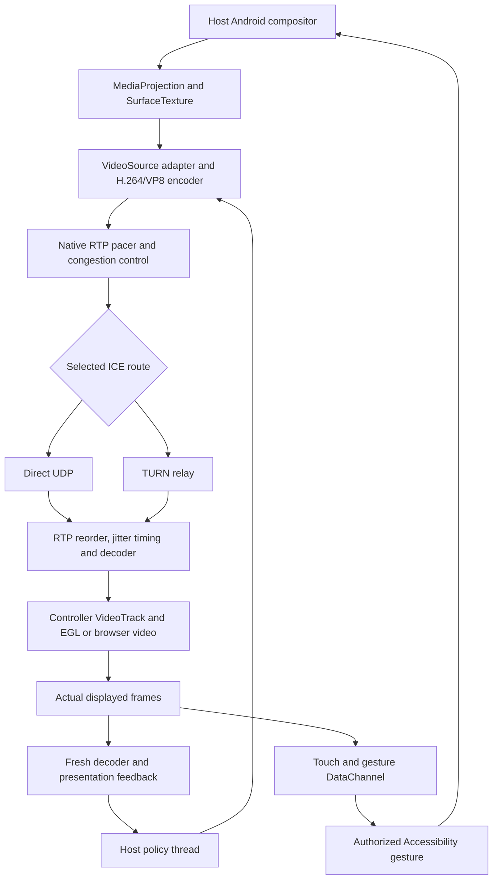

# Frame supply, display pacing and clarity audit

Baseline: `main` at `f3167f2a8db165a1b42877965fbe267ed634642a`.
Delivery version: 1.9.59 (147).
Scope: Android phone-to-phone primary video, controller feedback, and the shared browser receiver. The production dependency is `io.github.webrtc-sdk:android:150.7871.01`. Frame timing below is illustrative; physical phone performance has not been measured in this environment.

## Dependency skeleton

| Subsystem | Ownership and execution path | Ripple when changed |
| --- | --- | --- |
| App and session | `RemoteApp`, `MainActivity` → `SessionCoordinator` / `SessionRuntime` → host or controller connection service | Approval, session lease and display generation fence all input and feedback. Media fixes must preserve these fences. |
| Capture | `ScreenShareService` → `HostWebRtcSession` → `ScreenCaptureTrack` → `ScreenCapturerAndroid` / `SurfaceTextureHelper` → `VideoSource` / `VideoTrack` | FPS/pixel ceilings change the native source adapter. Virtual-display geometry changes only for actual display shape changes. Natural video is submitted before optional CPU snapshots. |
| Codec | `WebRtcRuntime` → hardware/software factories; `WebRtcPeer` → `ScreenCodecPolicy` and sender transceiver | Codec or input-dimension changes can reconfigure MediaCodec. Stable dimensions and evidence-based changes reduce unnecessary interruptions. |
| Transport | `WebRtcPeer` → native encoder, RTP packetization, congestion control, pacing, SRTP and ICE | Libwebrtc owns send pacing and loss recovery. Signaling through `CloudflareSignalingClient` establishes direct UDP or TURN; ordinary RTP frames do not pass through Worker screenshot APIs. |
| Receiver | `ControllerWebRtcSession` / browser `RTCRtpReceiver` → native packet reorder, jitter timing, NACK, decoder → remote `VideoTrack` | Buffering absorbs short arrival variations. Sustained codec or network shortages require workload relief. |
| Android display | `InlineRemoteControllerView` → `EglThread` / `EglRenderer` → Surface / Android compositor | One replaceable pending frame preserves freshness. Swap listeners prove EGL presentation, rather than merely counting decoded frames. Surface recovery retains the functioning peer and track where possible. |
| Browser display | `browser-console.js` → HTML video / `requestVideoFrameCallback`; `receiver-playout.js` | Adaptive target 100 → 150 → 250 → 350 → 500 ms when supported. Only accepted application smoothing is discounted from excess-delay feedback. Hidden tabs and missing statistics invalidate clean recovery time. |
| Adaptive policy | `HostWebRtcSession` policy thread → `ReceiverVideoFeedback`, `PhotonFreshnessGovernor`, `MotionVideoBudget`, `VideoCadenceGovernor`, `CaptureQualityGovernor` | Frame-supply measurements, fresh decoder/render windows and queue pressure determine source ceilings. Reusing a retained measurement as a new event can cause unwanted FPS or resolution changes. |
| Remote input | controller gesture pacer → DataChannel → `ControlProtocol` / command gate → `AssistAccessibilityService` → screen changes | Ordered commands and ACKs coexist with the freshness-oriented gesture lane. Input does not wait for the video playout buffer. Applied input schedules one coalesced capture-refresh probe. |
| Compatibility and AI | `FallbackScreenStreamer`, `AiSnapshotProvider` and AI services | JPEG/delta recovery and requested snapshots are auxiliary CPU consumers. They share the projection, but are not the normal video transport. |
| Backend and diagnostics | pairing/signaling backend, browser/MCP Workers, `ConnectionFlightRecorder`, QD media overlay | Backend health does not prove video smoothness. Existing source/encode/decode/EGL/queue metrics provide the bottleneck evidence. |

## Frame and control map

## UI and state map

| User action or event | State and logic | Visible result |
| --- | --- | --- |
| Host approves control and grants screen capture | Session lease activates after projection, connectivity, control and Accessibility prerequisites | Controller enters the live screen after the first decoded track and confirmed display swap. |
| Controller touches or swipes | Gesture packets apply on the host; the policy lane activates interaction priority and a bounded motion envelope | Fresh screen changes travel through the existing video stream. Higher requested FPS remains a ceiling, not evidence that those frames were produced. |
| Screen produces 30 updates/sec while the ceiling is 60 | The encoder and renderer may both correctly deliver 30 updates/sec | A supply-aware comparison must preserve the ceiling rather than classify the missing 30 hypothetical frames as a GPU stall. |
| Encoder supplies 60 updates/sec but display drops to 20 with long gaps | Fresh upstream and presentation evidence disagree | Existing bounded fast relief remains available; native congestion control and the full telemetry loop retain their stronger pressure checks. |
| A single EGL hitch is retained across two sender polls | Receiver feedback marks the repeated window `presentationSampleFresh=false` | The repeated sample remains useful for diagnosis. It must not become a second resolution-pressure vote and trigger a clarity cliff. |
| Finger lifts while fling or animation continues | Passive motion and the existing interaction tail keep freshness priority active | Policy follows continuing screen updates; settled detail recovers through the established idle/quality rules. |
| Rotation, codec change or RTP stream replacement | Display generations, telemetry baselines and fast upstream evidence reset appropriately | Old stream cadence cannot tune a new decoder or surface. |

## Surgical defects and corrections

### 1. Requested FPS was mistaken for supplied FPS

At `HostWebRtcSession.onControlMessage(PresentationFeedback)`, the host invokes `VideoCadenceGovernor.observeFastPresentation`. The baseline fast path computes `renderedFPS / requestedFPS`. Unlike the full statistics path, it does not account for the sender's measured supply.

Example: ceiling 60, sender 30, displayed 15 frames in 500 ms, maximum gap 34 ms. Every supplied frame is displayed evenly. The baseline nevertheless computes delivery ratio 0.5 and classifies it as severe, trimming 60 → 58. Repeated naturally sparse screen updates can ratchet the ceiling down and set an overload cooldown even though codec and network queues are clean.

Correction: the existing governor retains only scalar FPS/identity/time from its most recent completed outbound window. The fast path compares against `min(ceiling, measured upstream FPS)` and derives its gap budget from that rate. Unknown, expired, future-clock, empty, or overly long sender windows cannot establish fast renderer pressure. Stream/codec replacement clears evidence even before a new complete window arrives. A short probe on the same stream preserves a recent complete measurement. No new statistics timer, media queue, frame copy or control protocol is introduced.

Cache bounds: completed sender window 500–2000 ms; receipt age 0–1500 ms. Very sparse supply below the existing 10 FPS presentation-measurement floor is left to the full capture/codec/transport diagnostic path. Actual high-rate supply with persistent display stalls still receives the established bounded one-rung relief.

### 2. Held display evidence was counted twice for pixels

`ReceiverVideoFeedback.consume` retains a recent EGL cadence window briefly to bridge independently phased render and WebRTC statistics clocks. It explicitly marks a reused sample as held. `VideoCadenceGovernor` already respects that marker in its full pressure path; the baseline `MotionVideoBudget.observe` presentation-pressure branch does not.

A single hitch can therefore supply both votes needed for a resolution downshift. That sacrifices text detail and may cause an avoidable encoder-dimension change while the controller is interacting.

Correction: require fresh presentation evidence for the motion pixel governor's presentation-pressure vote. Two distinct fresh hitches still count. Independently measured encoder, decoder, bandwidth and queue pressure remain active even when the EGL sample is held. Held evidence can still conservatively block upward recovery.

## Timing and the buffer reservoir

At 30 real frames/sec, evenly paced screen updates are about 33.3 ms apart; at 60 they are about 16.7 ms apart. A requested 60 FPS ceiling cannot manufacture 60 distinct screen updates from a producer supplying 6.

| Frame | Capture time | Encode complete | Receiver arrival | Buffered presentation |
| --- | ---: | ---: | ---: | ---: |
| 1 | 0 ms | 8 ms | 50 ms | 100 ms |
| 2 | 33 ms | 42 ms | 81 ms | 133 ms |
| 3 | 67 ms | 75 ms | 117 ms | 167 ms |
| 4 | 100 ms | 108 ms | 147 ms | 200 ms |

This is an example of smoothing modest arrival jitter, not a measured promise. If average inflow stays below outflow, the reservoir drains. Increasing its depth only postpones the shortage and makes control feedback older. The app already delegates packet pacing and timestamp scheduling to libwebrtc, spends pixels under proven pressure, and uses bounded receiver smoothing. These corrections remove false adaptation decisions in that architecture.

Android's RTP playout hint is best-effort 10–500 ms; it does not impose a permanent 500 ms hold. Browser target changes and Android native jitter scheduling are distinct. Google's public WebRTC sources describe native adaptation, pacing and best-effort playout timing; this audit makes no claim about private WhatsApp tuning parameters.

## Evidence from the previously supplied recordings

The files `1000043400.mp4` and `1000043402.mp4` were inspected directly. They are historical evidence, not a run of this new build. The long recording around video time 45 s shows the host trace at session time +212.9 s:

| Recorded field | Visible value |
| --- | ---: |
| Source FPS | 6 |
| Requested target FPS | 15 |
| Recent encoded FPS | 12 |
| Decoder feedback FPS | 3 |
| Recent encoder service | 25 ms |
| Sender queue | 0 ms |
| Reported RTT | 4 ms |
| Reported packet loss | 0.0% |
| EGL presented FPS and max gap | Unavailable (`null`) |
| Encoded dimensions | 240 × 532 |
| Encoder implementation | `c2.mtk.avc.encoder` |

Nearby intervals show varying source supply and approximately 20–44 ms reported encode service, while the target remains 15 FPS. These telemetry windows are independently phased; their ratios cannot establish exact packet or frame loss. Missing EGL telemetry also prevents locating the final display bottleneck. The evidence does establish that the recorded system was not demonstrating sustained 30/60 FPS screen updates, and that merely adding a larger reservoir cannot supply missing frames. Recordings alone cannot determine whether the latest installed APK contains the subsequent main-branch fixes.

## Validation

The unchanged baseline failed seven of the new regression cases in a 49-test targeted run. After the core changes, 126 tests passed across eleven production-governor suites, compiled against the actual pinned WebRTC Java classes and Android API 36. The tests include real pressure relief, high-cadence probes, motion pixel budgeting, freshness deadlines, source-supply expiry and stream changes.

The companion [auto-fixer](../tools/fix_presentation_supply.py) checks exact baseline/fixed hashes before applying complete patches. It supports dry checking, idempotent reruns and refusal of unknown source versions. Example: `python3 tools/fix_presentation_supply.py --check`, then `python3 tools/fix_presentation_supply.py` on the audited baseline. Source changes after this audit are refused rather than guessed at.

| Check | Result and limit |
| --- | --- |
| Full Gradle Android unit suite | **442 tests in 82 suites passed**, zero failures/errors/skips. |
| Debug and release lint | Passed, zero errors. Existing warnings remain: 99 debug, 98 release. |
| Debug and release APK assembly | Passed. Both report version 1.9.59 / code 147 and contain the native WebRTC libraries. Release output is unsigned; no release signing or phone installation was performed. |
| Receiver playout and browser link unit suites | **27/27 passed**. |
| MCP Worker unit suite | **27/27 passed** in the final run after the Android compiler/lint workload finished. The unchanged baseline also passed 27/27. Earlier loaded runs intermittently exhausted the existing fixture's 100 `setImmediate` polls before asynchronous admission; no unrelated Worker or test-harness change was made. |
| Deployed browser link and agent smoke checks | Passed signaling, TURN-credential retrieval, controller replacement/STOP fencing, synthetic-host ACK, deduplication and server-readable JPEG checks. These checks do not establish physical video smoothness. |
| Browser screenshot fallback integration | Passed using available Chromium 142.0.7444.61. Only the test launcher's executable path was adjusted in a temporary copy; page code and assertions were unchanged. |
| Actual browser RTP video / SCTP integration | **Not verified**: the local attempt timed out waiting for `Live`. SDP offer/answer succeeded, but no ICE candidates appeared. An independent minimal peer probe reproduced missing candidates in both blank and secure test pages. The expected Playwright Chromium binary was unavailable; the fallback binary cannot substitute for a passing repository CI run. |
| Two physical Android phones | **Not run**: no devices are attached. |

Full Android command: `gradle :app:testDebugUnitTest :app:lintDebug :app:lintRelease :app:assembleDebug :app:assembleRelease`. It completed successfully with JDK 17, Android API 36 and the repository's pinned Gradle/AGP/Kotlin/WebRTC versions. Passing unit/build checks establish the policy correction and build compatibility; they do not establish capture, hardware-codec or compositor throughput on a phone.

Repository delivery uses `fix/producer-aware-glass-cadence-20261008` and its pull request. Publication and final merging are explicitly authorized. The merge gate is successful repository CI for the reviewed head; local build results above remain separate from repository CI and physical two-phone performance.

Before claiming improved phone-to-phone smoothness, compare the baseline and new build on the same two phones for at least ten minutes each: Wi-Fi/direct, mobile/TURN, continuous scrolling, tap-driven transitions, static text, rotation and sustained animation. Record source, encoded, decoded and presented FPS; EGL gap p95/p99/max; freeze counts; encoded dimensions; bitrate/BWE; RTT/loss; encode/decode service; send queue; actual/target jitter residence; and thermal state. Measure truly causal touch-to-visible latency with a screen marker or external camera. ACK-to-next-swap is only a proxy because a buffered swap can contain an older frame.

Public references:

- [WebRTC video adaptation](https://webrtc.googlesource.com/src/+/21b5db48da0a67c2ddb3d0f29884fc6174cba344/video/g3doc/adaptation.md)
- [WebRTC playout-delay extension](https://webrtc.googlesource.com/src/+/refs/heads/main/docs/native-code/rtp-hdrext/playout-delay/README.md)
- [Pinned Android dependency](../app/build.gradle.kts)
