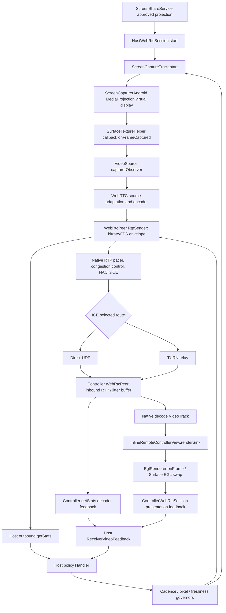
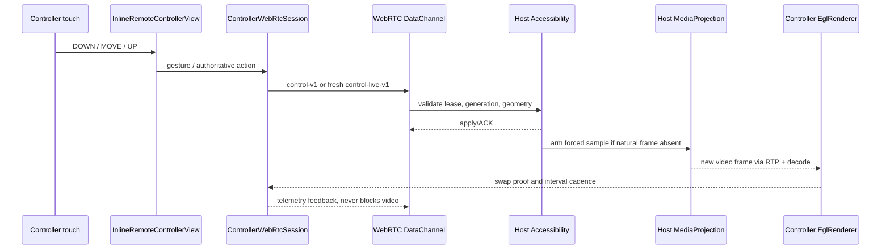

# Android remote screen: frame-to-glass audit (2026-10-08)

Baseline: `main` at `87d675b39153115f0d57df2cbb7892a83c6b40a5`. This document maps **the implemented path**, not a claimed two-phone performance result. Also read `VIDEO_PIPELINE_AND_PLAYOUT.md` for browser smoothing, RTP playout-hint history and codec source references.

## Dependency / call graph: actual interactive video

### Source and CPU/GPU allocation

1. `ScreenShareService.startTransport()` constructs the host; the user must approve MediaProjection.
2. `HostWebRtcSession.start()` registers the startup sink, adds the video track **before** capture, starts `ScreenCaptureTrack`, then starts the peer. Startup/capture watchdogs are separate from frame pacing.
3. `ScreenCaptureTrack.onFrameCaptured()` reads oriented geometry, normalizes forced-refresh timestamp and hands the *primary* frame to `VideoSource.capturerObserver` before its optional recovery snapshot sinks. Natural frames use the original GPU buffer, avoiding a per-frame Java CPU copy. `VideoSource.adaptOutputFormat` caps the encoder input; ordinary FPS policy changes do not recreate the MediaProjection virtual display.
4. `WebRtcRuntime` selects hardware codec factories where possible. `WebRtcPeer.addLocalVideoTrack` adds a SEND_ONLY transceiver, preferences H.264/VP8 according to device/negotiation and sets RTP `maxBitrateBps`, `maxFramerate` and `degradationPreference`. Motion policy permits native **spatial** downscaling to protect cadence; these are **ceilings**, not promised output.
5. WebRTC handles encode scheduling, congestion control, RTP pacing, packetization, ICE/direct or TURN relay, NACK recovery and decodable-frame scheduling. Cloudflare HTTP is for signaling/session coordination, not a JPEG proxy for normal RTP video.
6. Controller `WebRtcPeer` establishes a RECV_ONLY transceiver. Incoming RTP passes through native reorder/jitter/decode. `InlineRemoteControllerView.renderSink` forwards decoded frames directly to `EglRenderer`; its freshness-oriented renderer keeps only one replaceable pending frame.
7. EGL render callbacks update `PresentationCadenceTracker`; `ControllerWebRtcSession` sends `PresentationFeedback` and independent heartbeat/capability packets. Inbound `getStats` sends decoder windows.
8. `HostWebRtcSession.onVideoHealth` combines full outbound stats windows, receiver decoded/presented evidence, source FPS, queue/jitter residence, thermal state and input activity. `MotionVideoBudget`, `VideoCadenceGovernor` and `PhotonFreshnessGovernor` adjust capture format and RTP sender limits as one ordered transition.

### Input/UX state machine

UI interactions: capture startup (permission pending → projected); connection (signaling → ICE/DTLS → active video); playback (decoded frame → EGL swap → primary-video confirmation); fault (missing decoded frames → in-session recovery; missing EGL swaps despite decoded frames → renderer rebuild rather than immediately switching codec); rotation (source geometry → display generation → viewport/orientation update). Safety/lifecycle is managed by foreground services and session lease.

### Alternative video paths (not the normal video call)

- Browser remote console: `cloudflare/receiver-playout.js` implements browser-only adaptive `jitterBufferTarget` ladder 100/150/250/350/500 ms. This is a **target preference**, never a constant fixed delay. Android native does not expose the same public setter in the pinned SDK.
- Fallback: `FallbackScreenStreamer` attaches a temporary snapshot sink only for recovery. Its bounded GPU-to-CPU I420 handoff and JPEG/delta encoding are **not** a replacement for normal realtime RTP. Sustained fallback activation can increase capture callback cost and should be diagnosed separately.
- Control transport: reliable authoritative commands, fresher gesture samples and telemetry are separate DataChannel classes, avoiding expensive image traffic behind gesture ACKs.

## The confirmed sampling bug fixed in this branch

Prior to this change the host called `receiverFeedback.consume(...)` on **every** outbound stats callback, even when `VideoHealthWindowTracker.sample()` returned `recent == null` for the first sample, 100/120 ms one-shot probes, stream reseeds or sub-500 ms windows.

The feedback consumer is one-shot for decoder/presentation samples. Therefore an early getStats callback could clear a valid decoder freeze, dropout or EGL hitch report **without any paired outbound window to analyze it**. A later valid sender interval then saw missing receiver evidence. This can prevent the actual downstream bottleneck from influencing the cadence/pixel governor. It is not a proven explanation for all user-observed freezes.

Fix: `HostWebRtcSession` passes `senderWindowReady = snapshot.recent != null` to `ReceiverVideoFeedback.consume`. An incomplete sender interval returns null **without draining pending receiver windows**; existing identity/sequence checks, age limits, no-duplicate proof semantics and window aggregation remain intact. Regression tests cover early probe → paired decoder+EGL feedback, and bounded expiry.

An initial thread race concern was ruled out: all feedback `accept` calls and sender-side `consume` are routed onto the same host policy handler, so no new locking or queues are needed.

## Frame interval and latency budget

At 30 distinct FPS each output frame interval is ~33.3 ms; at 60 distinct FPS ~16.7 ms. A 100 ms reservoir covers about three 30 FPS frame intervals; 500 ms covers about fifteen, but at the cost of potentially obvious control lag. **These are interval counts, not native Android buffer guarantees.**

Pipeline timing must be decomposed into: source-frame interval, capture callback, encoder residence, RTP send-queue delay, network transit/jitter, jitter-buffer residence, decode service time, compositor/EGL wait, and display scanout. For remote input add gesture uplink and Android application/input scheduling before the next host capture. A controller-clock ACK-to-next-swap sample is *not* proof that the screen shows the action yet.

### Bottleneck decision matrix (diagnose before changing knobs)

| Evidence | Most likely layer | Safe tuning / action |
| --- | --- | --- |
| Source FPS << requested FPS | MediaProjection/producer/OEM/thermal/sparse scene | Compare motion vs idle, capture samples and thermal; avoid pointless network buffering |
| Source healthy, encoded FPS low; encode time high | Hardware codec / input pixel rate / software fallback | Lower input pixels first; preserve achievable motion FPS; check codec implementation |
| Encoded FPS healthy, send queue grows, low estimated capacity | Transport/bitrate envelope | Reduce pixel rate and bitrate, respect native GCC/TWCC; avoid adding a second sender queue |
| Network stable, decoded FPS low, decoder slow/drops | Receiver decode overload | Reduce encoded resolution/cadence based on *fresh* decoder feedback |
| Decoded FPS healthy, EGL swaps sparse | Renderer/surface lifecycle/CPU/GPU | Inspect `InlineRemoteControllerView`, surface state and swap cadence; do not assume codec failure |
| Only browser viewer jitters; measured floor approaches target | Browser jitter starvation | Bounded one-rung reservoir increases; downshift after clean windows |
| Rotation causes odd crop/touch offset | Geometry/display generation/viewport | Verify actual producer dimensions, aspect transition and frame-generation fencing |
| RTP stops but fallback JPEG appears | ICE, codec or decoder startup | Check candidate route, RTP stats and recovery triggers separately |

Never interpret a static screen's few distinct frames as a moving stream's throughput failure. Never promise zero dropped frames under packet loss, sustained insufficient bandwidth or thermal overload.

## Two-device acceptance gate before merge/deployment

Run the same build on both physical devices for at least 10 minutes on each path: same Wi-Fi, two mobile connections/TURN, vertical scroll, fullscreen game, portrait↔landscape, prolonged idle→touch, battery saver and warm/thermal stress. Capture stats in synchronized monotonic windows (no guessed network one-way delays):

- host: capture-source FPS, encoded/sent FPS, codec implementation, frame dimensions, totalEncodeTime/framesEncoded, outbound bitrate, qualityLimitationReason, send queue residence, RTT/loss and candidate route;
- controller: received/decoded FPS, decode cost, dropped/freezes, jitterBufferDelay and jitterBufferTargetDelay per emitted frame, actual EGL swaps, presentation gap p95/max, surface events;
- interaction: gesture start, authoritative ACK, first **correlated changed pixel** or external camera measurement. Compare smoothness **and** action latency, not FPS alone.

Acceptance: no new black-screen/rotation/control regressions; no growing send/decoder queue; receiver evidence survives early getStats probes; stable visual cadence improves without pushing control latency into an unacceptable buffer. Local unit tests or CI cannot establish an actual 2-phone FPS, p95 delay, or physical smoothness result.
