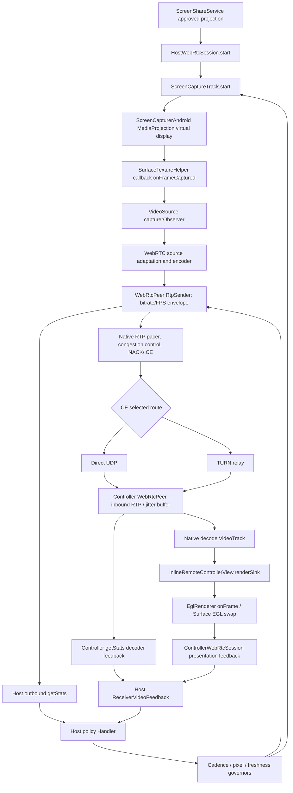
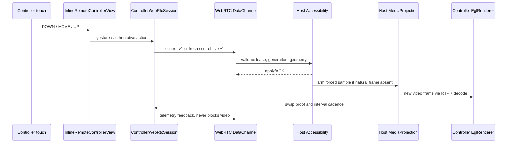

# Android remote screen: frame-to-glass audit (2026-10-08)

Baseline: `main` at `87d675b39153115f0d57df2cbb7892a83c6b40a5`. This document maps **the implemented path**, not a claimed two-phone performance result. Also read `VIDEO_PIPELINE_AND_PLAYOUT.md` for browser smoothing, RTP playout-hint history and codec source references.

## Dependency / call graph: actual interactive video



### Source and CPU/GPU allocation

1. `ScreenShareService.startTransport()` constructs the host; the user must approve MediaProjection.
2. `HostWebRtcSession.start()` registers the startup sink, adds the video track **before** capture, starts `ScreenCaptureTrack`, then starts the peer. Startup/capture watchdogs are separate from frame pacing.
3. `ScreenCaptureTrack.onFrameCaptured()` reads oriented geometry, normalizes forced-refresh timestamp and hands the *primary* frame to `VideoSource.capturerObserver` before its optional recovery snapshot sinks. Natural frames use the original GPU buffer, avoiding a per-frame Java CPU copy. `VideoSource.adaptOutputFormat` caps the encoder input; ordinary FPS policy changes do not recreate the MediaProjection virtual display.
4. `WebRtcRuntime` selects hardware codec factories where possible. `WebRtcPeer.addLocalVideoTrack` adds a SEND_ONLY transceiver, preferences H.264/VP8 according to device/negotiation and sets RTP `maxBitrateBps`, `maxFramerate` and `degradationPreference`. Motion policy permits native **spatial** downscaling to protect cadence; these are **ceilings**, not promised output.
5. WebRTC handles encode scheduling, congestion control, RTP pacing, packetization, ICE/direct or TURN relay, NACK recovery and decodable-frame scheduling. Cloudflare HTTP is for signaling/session coordination, not a JPEG proxy for normal RTP video.
6. Controller `WebRtcPeer` establishes a RECV_ONLY transceiver. Incoming RTP passes through native reorder/jitter/decode. `InlineRemoteControllerView.renderSink` forwards decoded frames directly to `EglRenderer`; its freshness-oriented renderer keeps only one replaceable pending frame.
7. EGL render callbacks update `PresentationCadenceTracker`; `ControllerWebRtcSession` sends `PresentationFeedback` and independent heartbeat/capability packets. Inbound `getStats` sends decoder windows.
8. `HostWebRtcSession.onVideoHealth` combines full outbound stats windows, receiver decoded/presented evidence, source FPS, queue/jitter residence, thermal state and input activity. `MotionVideoBudget`, `VideoCadenceGovernor` and `PhotonFreshnessGovernor` adjust capture format and RTP sender limits as one ordered transition.

### Input/UX state machine



UI interactions: capture startup (permission pending → projected); connection (signaling → ICE/DTLS → active video); playback (decoded frame → EGL swap → primary-video confirmation); fault (missing decoded frames → in-session recovery; missing EGL swaps despite decoded frames → renderer rebuild rather than immediately switching codec); rotation (source geometry → display generation → viewport/orientation update). Safety/lifecycle is managed by foreground services and session lease.

### Alternative video paths (not the normal video call)

- Browser remote console: `cloudflare/receiver-playout.js` implements browser-only adaptive `jitterBufferTarget` ladder 100/150/250/350/500 ms. This is a **target preference**, never a constant fixed delay. Android native does not expose the same public setter in the pinned SDK.
- Fallback: `FallbackScreenStreamer` attaches a temporary snapshot sink only for recovery. Its bounded GPU-to-CPU I420 handoff and JPEG/delta encoding are **not** a replacement for normal realtime RTP. Sustained fallback activation can increase capture callback cost and should be diagnosed separately.
- Control transport: reliable authoritative commands, fresher gesture samples and telemetry are separate DataChannel classes, avoiding expensive image traffic behind gesture ACKs.

## The confirmed sampling bug fixed in this branch

Prior to this change the host called `receiverFeedback.consume(...)` on **every** outbound stats callback, even when `VideoHealthWindowTracker.sample()` returned `recent == null` for the first sample, 100/120 ms one-shot probes, stream reseeds or sub-500 ms windows.

The feedback consumer is one-shot for decoder/presentation samples. Therefore an early getStats callback could clear a valid decoder freeze, dropout or EGL hitch report **without any paired outbound window to analyze it**. A later valid sender interval then saw missing receiver evidence. This can prevent the actual downstream bottleneck from influencing the cadence/pixel governor. It is not a proven explanation for all user-observed freezes.

Fix: `HostWebRtcSession` passes `senderWindowReady = snapshot.recent != null` to `ReceiverVideoFeedback.consume`. An incomplete sender interval returns null **without draining pending receiver windows**; existing identity/sequence checks, age limits, no-duplicate proof semantics and window aggregation remain intact. Regression tests cover early probe → paired decoder+EGL feedback, and bounded expiry.

An initial thread race concern was ruled out: all feedback `accept` calls and sender-side `consume` are routed onto the same host policy handler, so no new locking or queues are needed.

## Frame interval and latency budget

At 30 distinct FPS each output frame interval is ~33.3 ms; at 60 distinct FPS ~16.7 ms. A 100 ms reservoir covers about three 30 FPS frame intervals; 500 ms covers about fifteen, but at the cost of potentially obvious control lag. **These are interval counts, not native Android buffer guarantees.**

Pipeline timing must be decomposed into: source-frame interval, capture callback, encoder residence, RTP send-queue delay, network transit/jitter, jitter-buffer residence, decode service time, compositor/EGL wait, and display scanout. For remote input add gesture uplink and Android application/input scheduling before the next host capture. A controller-clock ACK-to-next-swap sample is *not* proof that the screen shows the action yet.

### Bottleneck decision matrix (diagnose before changing knobs)

| Evidence | Most likely layer | Safe tuning / action |
| --- | --- | --- |
| Source FPS << requested FPS | MediaProjection/producer/OEM/thermal/sparse scene | Compare motion vs idle, capture samples and thermal; avoid pointless network buffering |
| Source healthy, encoded FPS low; encode time high | Hardware codec / input pixel rate / software fallback | Lower input pixels first; preserve achievable motion FPS; check codec implementation |
| Encoded FPS healthy, send queue grows, low estimated capacity | Transport/bitrate envelope | Reduce pixel rate and bitrate, respect native GCC/TWCC; avoid adding a second sender queue |
| Network stable, decoded FPS low, decoder slow/drops | Receiver decode overload | Reduce encoded resolution/cadence based on *fresh* decoder feedback |
| Decoded FPS healthy, EGL swaps sparse | Renderer/surface lifecycle/CPU/GPU | Inspect `InlineRemoteControllerView`, surface state and swap cadence; do not assume codec failure |
| Only browser viewer jitters; measured floor approaches target | Browser jitter starvation | Bounded one-rung reservoir increases; downshift after clean windows |
| Rotation causes odd crop/touch offset | Geometry/display generation/viewport | Verify actual producer dimensions, aspect transition and frame-generation fencing |
| RTP stops but fallback JPEG appears | ICE, codec or decoder startup | Check candidate route, RTP stats and recovery triggers separately |

Never interpret a static screen's few distinct frames as a moving stream's throughput failure. Never promise zero dropped frames under packet loss, sustained insufficient bandwidth or thermal overload.

## Two-device acceptance gate before merge/deployment

Run the same build on both physical devices for at least 10 minutes on each path: same Wi-Fi, two mobile connections/TURN, vertical scroll, fullscreen game, portrait↔landscape, prolonged idle→touch, battery saver and warm/thermal stress. Capture stats in synchronized monotonic windows (no guessed network one-way delays):

- host: capture-source FPS, encoded/sent FPS, codec implementation, frame dimensions, totalEncodeTime/framesEncoded, outbound bitrate, qualityLimitationReason, send queue residence, RTT/loss and candidate route;
- controller: received/decoded FPS, decode cost, dropped/freezes, jitterBufferDelay and jitterBufferTargetDelay per emitted frame, actual EGL swaps, presentation gap p95/max, surface events;
- interaction: gesture start, authoritative ACK, first **correlated changed pixel** or external camera measurement. Compare smoothness **and** action latency, not FPS alone.

Acceptance: no new black-screen/rotation/control regressions; no growing send/decoder queue; receiver evidence survives early getStats probes; stable visual cadence improves without pushing control latency into an unacceptable buffer. Local unit tests or CI cannot establish an actual 2-phone FPS, p95 delay, or physical smoothness result.

## Follow-up: continuous EGL liveness (1.9.58 / 146)

The former `InlineRemoteControllerView.mediaWatchdog` was only rescheduled
while the first frame or the first EGL render was missing. After the first
successful render it stopped. A later Android Surface/EGL stall with decoder
frames still arriving could therefore remain undetected by this watchdog;
decoder-only liveness was not proof of current display progress.

The controller now records the most recent **actual EGL swap** independently
of the most recent **decoded VideoSink callback**. After a healthy start the
existing watchdog checks only those timestamps every 1.5 s. A renderer repair
is allowed only when the display is visible/valid, presentation has stopped for
at least 3 seconds, decoded frames arrived **after** the last swap and one was
received within the last 2 seconds. Absent input/decoder frames or a destroyed
Surface must not falsely trigger a GL reset. Renderer repair uses the existing
bounded two-attempt recovery; no media queues, frame interpolation, pixel
copies, codec negotiation or ICE paths were changed.

Unit tests cover sustained post-start EGL stalls, healthy swaps, static/absent
producer output, hidden/destroyed surfaces, initial startup and inconsistent
monotonic timestamps. A green CI means only software regressions were tested.
A physical Android controller plus sharing Android phone must still validate
swap gaps, GPU contention, recovery cadence, rotation and touch-to-visible
latency for at least 10 minutes. This patch repairs **stalls after an initially
successful rendering session**; it does not claim to fix upstream 2-fps
encoding or bandwidth-limited RTP delivery.


## Follow-up: bounded watchdog remains observable after retries (October 8, 2026)

Audited parent: `49e69fdd3bc308c6f5c4a7402eea9ec5c3e04a3d`
(PR #555 already contains the post-start EGL-stall detector).

**Verified lifecycle defect:** `InlineRemoteControllerView.mediaWatchdog`
stopped scheduling itself after either the transport or renderer repair
budget was exhausted. Therefore a late decoded frame, a successfully
recovered pending EGL swap, or a recreated `SurfaceView` could arrive after
the final watchdog check with no further periodic observation. In addition,
the pre-first-EGL-swap branch attempted renderer rebuild even when its Surface
was destroyed/hidden, consuming finite repair attempts with no output target.

**Targeted correction (not a new buffer or transport):**

- Keep the existing 1.5-second timestamp-only watchdog running after either
  finite retry budget is exhausted; this **does not** authorize further
  transport/renderer rebuilds once the budget is spent.
- Only attempt initial EGL repair when `rendererSurfaceAttached`, a valid
  `Surface` and a visible root agree. Preserve the already-conservative
  post-start `RendererContinuityPolicy.shouldRecover` gate.
- When a real `SurfaceHolder.surfaceCreated` arrives for an attached active
  remote video track, reset the **renderer-only** attempt budget, preserve the
  WebRTC session, and rearm the existing watchdog using the first-frame
  deadline. Do not spend the video transport recovery budget or create a new
  media track.

**State trace:**

```text
REMOTE_TRACK → FIRST_FRAME_WAIT → DECODED_PENDING_EGL
       ↘ NO_RTP → LIMITED_MEDIA_REPAIR → OBSERVE_ONLY (periodic)
DECODED_PENDING_EGL + NO_SURFACE → OBSERVE_ONLY (periodic)
DECODED_PENDING_EGL + VALID_SURFACE → LIMITED_EGL_REPAIR
       ↘ attempts exhausted → OBSERVE_ONLY (periodic)
SURFACE_RECREATED + ACTIVE_TRACK → REARM LIMITED_EGL_REPAIR
RENDER_SWAPPED → HEALTHY_MONITOR (periodic) → POST_START_EGL_STALL_CHECK
```

**Scope and test constraints:** This repairs two verifiable controller
watchdog-state defects and should not be represented as proof of lower
encoding/transmission jitter. The existing pure
`RendererContinuityPolicyTest` checks Surface gating and stale decode
evidence; Android build/lint jobs can check integration. Manual device
validation must additionally exercise: starting with a destroyed Surface,
two exhausted recovery attempts followed by a Surface recreation, later
decoded frames after transport-retry exhaustion, 10-minute continuous
presentation with both phones, portrait/landscape game transitions, and
that retry counters do not cause unbounded repairs. Measure separately
source FPS, encoded FPS, inbound decoded FPS, EGL swap FPS/gaps, RTP
jitter residence and action-to-changed-pixels delay; no simulated test can
establish physical two-phone smoothness.

## Controller decoder-liveness sampling fix (October 8, 2026)

### Verified integration mismatch

`WebRtcPeer` already samples incoming WebRTC RTP counters on a 500 ms
interaction cadence and 1,500 ms quiet cadence. In the controller,
`ControllerWebRtcSession.onVideoHealth` formerly returned early on a
3,000 ms *diagnostic logging throttle* **before** invoking
`InboundVideoLivenessMonitor.observe`. The monitor additionally counted
observations, rather than elapsed duration. Therefore the same stopped decoder
could take substantially longer to trigger media repair than the statistics
loop itself; changing logging frequency also changed recovery behavior.

### Surgical patch and state/visual mapping

Every existing inbound stats callback now feeds the monotonic
received/decoded counters and `SystemClock.elapsedRealtime()` to the
existing monitor. Only human-readable diagnostics remain throttled.
No additional RTCStats polling, RTP buffering, encoder, observer thread,
frame interpolation, signaling format, or UI layer is introduced.

```text
RECEIVE PROGRESS + DECODE PROGRESS → HEALTHY
RECEIVE PROGRESS + NO DECODE PROGRESS for 2,500 ms → REQUEST_RECOVERY
NO RECEIVE PROGRESS + NO DECODE PROGRESS for 12,000 ms → REQUEST_RECOVERY
NO FIRST DECODE YET → STARTUP WATCHDOG OWNS RECOVERY
REQUEST_RECOVERY + DECODE RESUMES → WAIT_FOR_ACTUAL_EGL_PRESENTATION
REQUEST_FAILED → RETRY AFTER 4,000 ms COOLDOWN
RTP COUNTER RESET / CLOCK DISCONTINUITY → RESEED, NO FALSE RECOVERY
```

Only a continuous observation interval that matches one of the two stall
conditions contributes to its timer; a quiet packet interval cancels previous
decoder-only evidence. Stream generation resets clear stale counters. The
controller's normal EGL presentation proof remains authoritative for turning
off fallback; a decoder counter alone must not declare visible recovery.

The 2.5/12/4-second thresholds are *policy deadlines*, not claims that
the network or hardware will recover within these durations. Delivery can
still be low-FPS when encoder workload, thermal constraints or insufficient
network capacity dominate. No additional '500 ms frame reservoir' was
implemented because a second video queue would increase input-to-screen lag.

### Regression and physical acceptance

Unit regression cases exercise high/low stats cadence, decoder-only stalls,
partial RTP gaps, idle/no-first-decode, recovery acknowledgment, cooldown,
monotonic clock and counter resets. CI is software-only. On two phones compare
sender source/encoded frame deltas with controller decoded and actual EGL-swap
cadence during scrolling, fullscreen games, portrait/landscape transitions,
low-bandwidth and static content. Record p95/max inter-swap gap plus visible
touch latency; diagnose codec/network stalls separately from EGL stalls.

## Follow-up: bound ineffective decoder-recovery requests (October 8, 2026)

### Verified code-level deadlock in the controller recovery state

In `InboundVideoLivenessMonitor.observe()`, a decoder stall triggers
`REQUEST_RECOVERY`, which sets `recoveryPending=true`. The controller sends
`VideoRecoveryRequest` to the host, or uses signaling recovery if its reliable
channel is unavailable. **Successful send only confirms request dispatch,
not resumed decoding or EGL presentation.** Previously `recoveryPending`
short-circuited every later stalled observation. With no new decoded frame,
`markPrimaryRecoveredConfirmed()` could never run, so a successful but
ineffective recovery request blocked subsequent attempts for the entire
unchanged stream.

This is distinct from a healthy decoder with a stopped Surface: the latter
remains owned by `InlineRemoteControllerView.mediaWatchdog` and
`RendererContinuityPolicy`. Transport/codec restart is not the primary
response to EGL-only stalls.

### Surgical correction

Keep the existing 2.5-second decoder-only and 12-second no-receive detection
deadlines, the same 4-second retry cooldown, and the existing session / glass
confirmation states. Permit **at most two** requests per unconfirmed decoder
failure (the initial request and one cooled-down follow-up). No additional
`getStats()` calls, threads, capture sessions, codecs, RTP buffering, frame
copies, frame interpolation, or new wire messages are introduced.

```mermaid
stateDiagram-v2
    [*] --> Healthy
    Healthy --> Stalled: decoder stops while RTP advances
    Stalled --> Pending1: first elapsed-time deadline
    Pending1 --> AwaitGlass: decode resumes
    Pending1 --> Pending2: still stalled and cooldown elapsed
    Pending2 --> AwaitGlass: decode resumes
    Pending2 --> ObserveOnly: still stalled; retry budget exhausted
    AwaitGlass --> Healthy: real EGL swap confirms primary
    ObserveOnly --> Healthy: real EGL swap / new stream generation
```



The retry budget resets only when actual primary presentation is confirmed,
the RTP generation resets, the monitor is reset on lease/track replacement,
or clock/counters discontinuity requires reseeding. A progressing decoder
does not trigger a second request merely because the renderer has not
confirmed a fresh EGL swap. Failed sends obey the same cooldown and bounded
attempt budget.

**Regression tests:** delivered-but-ineffective request, early cooldown,
no-receive/long-deadline retry, exhausted budget, healthy decoder without
glass confirmation, and budget renewal after a genuine presentation proof.

**Physical gate remains open:** compare this branch against baseline
`1c3e6114a857bf4b8edf046ca2771f8f23521113` on two Android phones for
10 minutes each with scrolling, a live game, idle-to-touch, portrait/landscape,
Wi-Fi and TURN/mobile data. Record encoder/source/decoder/EGL FPS, p95/max
render gap, RTP jitter/queue, ICE route and action-to-changed-pixels. A
unit/CI pass confirms the corrected state transitions but cannot guarantee
smooth physical playback. Persistent 2 FPS while source/encoder/network
throughput is inadequate is outside this surgical recovery fix.

## RTP stream identity during recovery (October 8, 2026)

### Code and visual intersection

`WebRtcPeer.videoStatsProbe` → `VideoHealthSnapshot.from` →
`VideoHealthWindowTracker.sample` → `ControllerWebRtcSession.onVideoHealth` /
`HostWebRtcSession.onVideoHealth` → codec/cadence/pixel governors →
`ScreenCaptureTrack.update` and `WebRtcPeer.updateInteractiveVideoPolicy`.

When a session replaces a video SSRC, a retired `outbound-rtp` or
`inbound-rtp` object can still appear in a WebRTC stats report. Counters
such as `bytesSent` and `bytesReceived` are **lifetime counters**, not
instantaneous transport throughput. Picking the greatest accumulated bytes
can select the old stream even if a new video stream is already active.
The UI can then show apparently frozen/stale stats and the host's adaptation
loop may optimize against the wrong RTP stream.

**Targeted change:** reject explicitly inactive candidates whenever at least
one candidate is not marked inactive; prioritize explicitly active candidates;
use the prior largest-lifetime-bytes choice when the SDK omits activity metadata.
The stats stream ID still fences interval histories on an actual stream switch.
No encoder, capture loop, RTP packet, native playout target, extra queue, input
lane or decoder callback is changed.

### Device trace to diagnose remaining stutter

1. Record concurrent moving-screen 500–1500 ms windows at source, encoder,
   receiver decoder, and actual controller EGL swaps; also retain the video
   stats object's stream ID and `active` state across reconnection.
2. If source FPS is low, inspect MediaProjection producer/thermal/OEM before
   adding buffering. If source is high but encoded FPS is low, inspect encode
   service time, hardware implementation and pixel envelope.
3. If encoded FPS is high but received/decoded FPS is low, inspect bandwidth
   estimate, send queue, selected ICE candidate route, jitter residence, RTP
   loss and decode cost. If decoded FPS is high but EGL swaps are low, investigate
   Surface lifecycle, EGL thread and presentation gap.
4. A 100–500 ms adaptive jitter buffer trades responsiveness for short-lived
   network recovery. It cannot reconstruct missing unique frames, and the
   Android native receiver has no browser-style application target setter in
   this pinned SDK.

**Tests:** three synthetic RTCStats reports check an active low-byte stream
against a high-byte retired SSRC; a not-explicitly-inactive stream against an
inactive one; and the older no-`active` compatibility fallback. Android
unit/lint/build CI and two physical phones remain required. This fix restores
stream-identity correctness; it does not by itself establish a higher FPS on
the user's bandwidth-limited 2 FPS path.

## Follow-up: presentation telemetry cannot bridge missing compositor time (October 8, 2026)

**Source-level defect:** The controller sends measured EGL cadence over an unordered,
non-retransmitted telemetry DataChannel. In `ReceiverVideoFeedback.accept(PresentationFeedback)`,
the pending presentation window was combined with the next packet without
checking when the preceding packet arrived. If compositor samples were lost
during a stall/visibility transition, this fabricated contiguous playback from
two separated intervals. It could retain an obsolete worst render gap or report
an inflated delivered FPS, misleading the existing cadence governor. The
decoder feedback path already enforced age bounds; presentation aggregation did not.

**Surgical fix:** Before combining, require the latest measured packet to
arrive within `incoming.intervalMs + 750 ms` of the preceding received packet,
also bounded by 3000 ms. If a measured interval is missing, discard the
unconsumed old presentation window and begin a new measured segment. This
guard is against missing **telemetry**, not a new video jitter buffer.
The prior valid sequence/lease checks, EGL rendering, codec negotiation,
frame timestamps, RTP transport, fallback behavior and independent heartbeat
remain unchanged. Three regression tests cover normal jitter-tolerant
aggregation, a lost-interval gap, and an expired bad window.

**Performance claim boundary:** This removes a false sampling signal; it does
not invent frames and cannot remedy source/encoded FPS dropping to 2 when
the codec, link capacity or screen producer is the actual bottleneck. The
physical acceptance gate remains a 10-minute A/B test on identical Android
devices, measuring source FPS, encoded FPS, decoded FPS, actual EGL swaps,
p95/max presentation gaps, round trip time, sender queue and touch-to-pixel
causality. Passing CI is not proof of Google Meet-like responsiveness.
