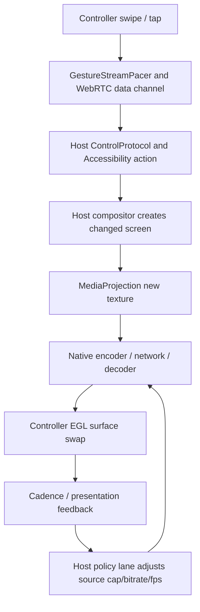

# Android-to-Android frame-to-glass audit — 2026-10-09

Base reviewed: `main` at `bc5409efa822d366c8264d3287f129bcd1de9a40`; targeted fix on `fix/renderer-frame-first-20261009`.
This is a source audit, not a measured certification of 60 FPS on real devices.

## 1. Dependency graph: actual media ownership

```mermaid
flowchart LR
  A[Host Android compositor] --> B[MediaProjection]
  B --> C[ScreenCapturerAndroid / SurfaceTextureHelper]
  C --> D[VideoSource adaptOutputFormat]
  D --> E[Native WebRTC H264/VP8 hardware encoder with fallback]
  E --> F[Native WebRTC RTP packetization / pacer / GCC-TWCC / SRTP]
  F --> G{Selected ICE candidate pair}
  G -->|direct| H[UDP]
  G -->|relay| I[TURN]
  H --> J[Receiver RTP reorder / NACK / native jitter timing]
  I --> J
  J --> K[Native WebRTC decoder]
  K --> L[Controller VideoTrack]
  L --> M[InlineRemoteControllerView renderSink]
  M --> N[EglRenderer / SurfaceView / Android compositor]
  N --> O[Actual EGL swap callbacks]
  O --> P[PresentationCadenceTracker / feedback DataChannel]
  P --> Q[Host video governors]
  Q --> D
  Q --> E
```



- Capture source: `capture/ScreenCaptureTrack.kt`, called by `webrtc/HostWebRtcSession.kt`; optional AI/fallback snapshot sinks run **after** the main WebRTC observer, but a synchronous GPU-to-CPU handoff may still consume the capture thread before the next texture.
- Encoder and ICE: `webrtc/WebRtcRuntime.kt`, `WebRtcPeer.kt`, `ScreenCodecPolicy.kt`. Native library `io.github.webrtc-sdk:android:150.7871.01` owns actual MediaCodec encoding/decoding, RTP pacing and jitter.
- Controller: `ControllerWebRtcSession.kt` receives the native decoded track; `ui/InlineRemoteControllerView.kt` submits each decoded frame into a *single* `EglRenderer`, which has a replaceable pending frame rather than an app-owned FIFO.
- Separate compatibility: `FallbackScreenStreamer.kt` uses JPEG/delta on a separate DataChannel as recovery. It must not be treated as the primary interactive video path.
- Cloudflare Worker performs session/pairing/signaling; ordinary native WebRTC screen RTP does **not** travel as Worker screenshot uploads.

## 2. User interaction/state map



DataChannel commands should not wait in a video playout buffer. At the first decoded frame and after rotation/reconnect, renderer health must be re-established by a real EGL swap rather than by RTP/decoder counters alone.

## 3. Timing model (illustrative, not measured)

For unique frame motion: 24 FPS ~= 41.7 ms between screen changes; 30 FPS ~= 33.3 ms; 45 FPS ~= 22.2 ms; 60 FPS ~= 16.7 ms. Raising a requested FPS cap cannot manufacture producer frames that MediaProjection did not deliver.

```text
Host capture : F1 -------- F2 -------- F3 -------- F4 (33ms nominal)
Encoder      :   F1 -------- F2 -------- F3 -------- F4
Network      :       F1 ------ F2 ---------- F3 --- F4
Jitter/glass :           F1 -------- F2 -------- F3 -------- F4
```

The jitter buffer absorbs *short* arrival variance. If either upstream supply or decoded frame output is permanently 1 FPS, a 100–500 ms buffer cannot create 30 fresh frames per second. A larger queue may make touch response stale even if wall-clock cadence looks less bursty. Keep native GCC/TWCC, packet pacing, NACK and jitter ownership.

## 4. Defect and branch status matrix

| Code site | Confirmed code behavior / risk | Status |
| --- | --- | --- |
| `WebRtcPeer.videoStatsInFlight` | An unreturned `getStats` callback can permanently suppress further video-health sampling; stale completion can contaminate a newer request | Bounded tokenized gate exists in draft PR #577 (CI reported success; device gate pending). |
| `VideoCadenceGovernor` | A retained bandwidth quality label alone could block recovery from a healthy low-FPS cap | Draft PR #579 (CI reported success; device gate pending). |
| `ScreenCaptureTrack.onFrameCaptured` | Host geometry callback was invoked before native `VideoSource` frame submission, adding avoidable capture admission ordering risk | Draft PR #580 puts admission first (CI reported success; device gate pending). |
| `InlineRemoteControllerView.renderSink` | Geometry calculation, UI posting and first-frame status work happened before enqueueing the decoded frame to EGL | This branch queues EGL first; no added queue, copy or renderer; CI and device gate required. |
| Native encoder/jitter/decode path | Hardware throughput, pacer residence, decoder implementation and actual jitter targets cannot be inferred from Kotlin alone | Needs paired real-device counters. |

Existing main fixes already distinguish source starvation from network congestion and do not treat a repeated forced texture as proof of new screen motion. Preserve those invariants.

## 5. Diagnostic decision tree

1. **Host source FPS low (e.g. 1–2) while moving**: inspect MediaProjection callback timestamps, OEM display cadence, capture thread pressure and CPU snapshot work. Do not reduce bitrate based only on a bandwidth label.
2. **Source healthy, encoded FPS low**: inspect hardware/software codec chosen, `totalEncodeTime / framesEncoded`, dimensions and overuse signals. Reduce pixel workload or adapt frame rate based on actual sustained service time.
3. **Encoded healthy, decoded low**: inspect receiver `framesReceived`, `framesDecoded`, loss, RTT, jitter target/actual, decoder cost and codec keyframe availability; never infer network loss from `qualityLimitationReason` alone.
4. **Decoded healthy, EGL swap low**: inspect surface lifecycle, renderer thread, actual swap cadence/max gap, UI overhead and display refresh. Check the new render-first change here.
5. **Swap healthy but swipe laggy**: inspect accumulated sender pacer delay + receiver jitter residence, stale frames after touch, actual vs requested playout delay, and gesture-to-new-pixel evidence.

Use stats *deltas* over contiguous 500–1500 ms windows. Reject stream-reset and disconnected samples. Measure rendered gap p50/p95/p99 and worst freeze, not just average FPS.

## 6. Acceptance gate

Compare baseline `bc5409` with patched branch on the **same two physical devices**, same Wi-Fi/direct ICE and mobile/TURN network, animated scrolling for >=10 minutes each, plus static screen, device rotation, two reconnects, low battery/thermal load.

Capture per-second host source FPS, encoded FPS, codec implementation and average encode ms; sender BWE, pacer queue, RTT, packet loss and ICE path; receiver framesReceived/decoded, decode ms, jitter residence/target, framesDropped/freezes; and *actual* EGL swaps with p95/p99/max gap. Measure touch-to-new-pixels; ensure a decrease in visible judder is not purchased with 500ms of avoidable stale latency.

GitHub CI and source checks can prove build/invariant integrity, **not** end-to-end smoothness or zero network loss.
