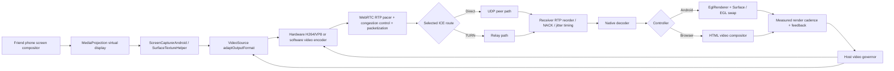

# Phone-to-phone frame journey and stutter fault map (2026-10-08)

Analyzed baseline: main `fb97d393ae01`, after PR #550. The diagnosis below distinguishes verified code behavior from unmeasured real-device hypotheses. This is a code/architecture map, **not** a claim of successfully measured phone-to-phone smoothness.

## 1. Full path: one frame



- **Capture:** `capture/ScreenCaptureTrack.kt` uses `ScreenCapturerAndroid`, `SurfaceTextureHelper`, `VideoSource`, and a `VideoTrack`. Natural texture frames are sent to `videoSource.capturerObserver` before optional snapshot sinks. `CaptureSampleClock` fixes duplicate sample timestamps. `CaptureActivityTracker` separates real motion from duplicate pulls. `ScreenCapturerAndroid.changeCaptureFormat` is reserved for actual display shape changes; routine FPS/pixel changes use `VideoSource.adaptOutputFormat`.
- **Encode:** `webrtc/WebRtcRuntime.kt`, `ScreenCodecPolicy.kt`, `WebRtcPeer.kt` negotiate a preferred hardware H264/VP8 codec with fallback. `RealtimeMediaPolicy.kt` selects `MAINTAIN_FRAMERATE` for motion, permitting native spatial relief rather than forcing late frames through an overloaded codec.
- **Send and network:** `WebRtcPeer.kt` creates a host `SEND_ONLY` transceiver, sets a sender bitrate/FPS ceiling and delegates pacing/congestion decisions to WebRTC. `CloudflareSignalingClient.kt` and ICE establish connectivity; normal video RTP traverses the selected peer/TURN path, **not** a sequence of Worker JPEG uploads.
- **Receive:** Libwebrtc reorders RTP, recovers eligible packets using NACK, applies native playout timing and decodes on receiver-owned threads. Android exposes receiver stats; browser `receiver-playout.js` requests a bounded `jitterBufferTarget` if supported. Sender best-effort RTP playout hint is 10..500 ms, not a guaranteed fixed hold.
- **Android glass:** `ui/InlineRemoteControllerView.kt` feeds decoded `VideoTrack` frames directly into `EglRenderer`, with latest-pending-frame rendering. The render listener timestamps an actual swap, then reports `PresentationCadenceWindow` through `ControllerWebRtcSession.kt`.
- **Browser glass:** `cloudflare/browser-console.js` uses `<video>`, `requestVideoFrameCallback` if available, `RTCRtpReceiver.getStats()`, and `cloudflare/receiver-playout.js`. Browser sender feedback uses a low-buffered data channel. On browsers without video-frame callbacks, `timeupdate` is a weak liveness fallback, **not** frame-accurate compositor proof.
- **Control return loop:** Touch/drag/gesture packets flow controller -> WebRTC data channel -> `HostWebRtcSession.kt` -> `AssistAccessibilityService`; applied actions may request one coalesced fresh screen sample. Input/ACK should not wait behind the video buffer. Browser/JPEG compatibility fallback is separate and must not become the normal media path.

## 2. Frame train: where smoothness is won or lost

For 30 *unique* FPS, a frame must complete the chain about every 33.3 ms. At 60 FPS, this is about 16.7 ms. Example:

```text
Source       0   33   67  100  133  167 ms
Encode        8   42   75  108  142  175 ms
RTP arrival  50   81  117  147  183  215 ms (illustrative only)
Display     100  133  167  200  233  267 ms
```

Those timestamps are a teaching example, **not** measurements from a device. The display can remain evenly paced when network arrivals vary modestly, as long as enough frames arrive *before their deadlines*. If the producer or network supplies only ~2 decodable FPS (one frame per 500 ms), a 100/500 ms buffer cannot manufacture the missing real screen updates. Frame interpolation may look smooth for a passive movie but can misrepresent a touch target and is not safe as a remote-control correctness mechanism.

A useful fluid-tank analogy: input rate must be at least output drain rate in the long run; the reservoir only absorbs short fluctuations. Under chronic congestion, reduce pixels/bitrate or select a sustainable FPS. A large permanent buffer conceals jitter at the cost of stale controls.

## 3. Three critical state loops

1. **Motion/producer:** real new capture timestamps -> `CaptureActivityTracker` -> `HostWebRtcSession.handleSourceMotionPulse` -> `MotionVideoBudget` / `VideoCadenceGovernor` -> `applyVideoPolicy`. Network/codec ceilings are increased before a risky pixel-rate upshift; source is reduced first during downshift.
2. **Decoder/controller:** per-interval decoded FPS, decode time, jitter-buffer residence, drops/freezes -> `ControllerWebRtcSession.sendTelemetry` -> `HostWebRtcSession.onControlMessage` -> `ReceiverVideoFeedback`. The host consumes receiver feedback on its policy lane during outbound stats.
3. **Presentation/controller:** actual EGL swap or browser compositor callbacks -> bounded presentation window/heartbeat -> receiver feedback and urgent host cadence relief. This must not be mistaken for a true touch-to-photon measurement: an EGL swap after ACK could still display a frame captured before the touch.

## 4. Code defect repaired in this branch

**Defect: asynchronous receiver stats lost between host samples.** In `ReceiverVideoFeedback.accept(VideoFeedback)`, the next packet previously overwrote `pending`. Controller decoder statistics and host outbound sampling clocks are not phase-locked; a 500 ms freeze/drop interval followed by a normal interval could be erased before the host adapted.

**Change:** bounded aggregation on the *existing* policy lane. Merge fresh same-lease decoder windows until the host consumes them, within 6000 ms / 2048 frames. Sum known loss/freeze counters; compute decoded-frame-weighted codec/jitter means; unknown metrics remain unknown. Old, oversized, reset/lease-separated samples do not mix. Existing presentation evidence aggregation and the actual RTP/render queues are unchanged.

This is an **adaptive-observability correction**, not a measured FPS increase. Unit tests cover phase-skew retention, upper bounds/expiry and absent statistics. Do not claim that this change alone resolves a 2 FPS network/capture condition.

## Decoder-feedback continuity correction (follow-up, 2026-10-08)

The native video frame path is unchanged. On the controller, `ControllerWebRtcSession.onVideoHealth` serializes completed decoder-stat deltas as `VideoFeedback` on the best-effort telemetry DataChannel. On the host, `ReceiverVideoFeedback.accept` holds these scalar windows until the next completed outbound sample calls `consume`. `VideoCadenceGovernor`, `MotionVideoBudget`, and `PhotonFreshnessGovernor` then compare sender/receiver health and choose source ceilings.

**Verified code defect:** before this correction, `ReceiverVideoFeedback.accept(VideoFeedback)` merged receiver windows whenever the previous report was less than three seconds old. Unlike the existing `PresentationFeedback` path, it did not check whether the decoder-report arrival spacing matched the incoming measurement interval. A missing 500 ms report could therefore join two non-contiguous intervals and manufacture healthy continuous decoder FPS. This could distort adaptation, although the missing feedback alone does not prove that actual RTP frames were dropped.

**Surgical correction:** reuse the existing one-use decoder aggregation but require the last report arrival to be within `min(3_000 ms, incoming interval + 750 ms)`. The incoming interval is essential: using the growing combined interval would admit unrelated decoder samples. Consecutive reports with ordinary scheduler/network jitter still merge. No new frame buffer, adaptive queue, extra thread, stats poll, RTP setting, codec, or wire format is introduced.

**Regression gate:** `VideoFeedbackTest` asserts that 30 decoded frames in one 500 ms interval followed by a 1.6 s reporting hole and a 3-frame/500 ms interval yields **6 FPS** for the fresh report—not a fabricated 33 FPS average. A 900 ms callback gap for consecutive 500 ms samples must still aggregate normally. These tests verify scalar feedback accounting, not real-device video smoothness.

## 5. Critical diagnostic decision tree for two physical phones

| Observation from matched 10-minute runs | Likely bottleneck | Safe follow-up |
| --- | --- | --- |
| Source FPS falls while sender encoder/pacer is healthy | MediaProjection/SurfaceTexture, game or device throttle | Record capture callback intervals and thermal status; avoid re-creating virtual display during gestures |
| Source 30+, encoded ~2, encode service high or `qualityLimitationReason=cpu` | Hardware codec fallback/overuse | Verify active encoder implementation, lower source resolution first |
| Encoded 30+, decoded ~2, RTT/loss/BWE/queue poor | Transport congestion, loss or recovery | Inspect ICE candidate type; keep GCC/TWCC and shrink pixels/bitrate before enlarging playout |
| Decoded 30+, EGL presented ~2 or repeated large swap gaps | Controller compositor/render thread | Record swap p95/p99/max and device refresh/thermal; inspect Surface lifecycle |
| Frames presented ~30 but touch looks delayed | Jitter residence or buffered old frames | Compare actual/target/accepted buffer and truly causal input-to-pixel marker |
| Browser smooth but Android stalls (same host/network) | Android decoder/EGL/Surface-specific problem | Compare matched codec, decode time, renderer gaps and display configuration |
| Android smooth but browser stalls | Browser compositor/policy/hidden-tab semantics | Check requestVideoFrameCallback cadence, target acceptance and stats fencing |

### Metrics to capture at minimum

For every 500-1000 ms motion interval: capture producer FPS; encoded and sent frames; encoder service time; sent pixel dimensions; bitrate ceiling and `availableOutgoingBitrate`; send-queue residence; candidate pair (direct vs relay), RTT and packet loss; receiver decoded frames, decoder cost, jitter-buffer actual/target; renderer presented FPS and max swap gap; and thermal status. Keep counters delta-based, reset baselines at stream/codec changes, and exclude idle/static intervals when estimating a motion FPS deficit.

### Acceptance gate (not yet satisfied)

Compare main `fb97d393ae01` with this branch on the **same two phones** for 10 minutes each: Wi-Fi, mobile/TURN, rotation, scrolling and animated content. Declare an improvement only if controller presentation p95/p99 gap and freezes fall without hiding increased input-to-visible latency. A build or CI pass proves code integrity, not physical smoothness. No real-world link can promise zero dropped frames or guaranteed 60 FPS under sustained inadequate bandwidth.
