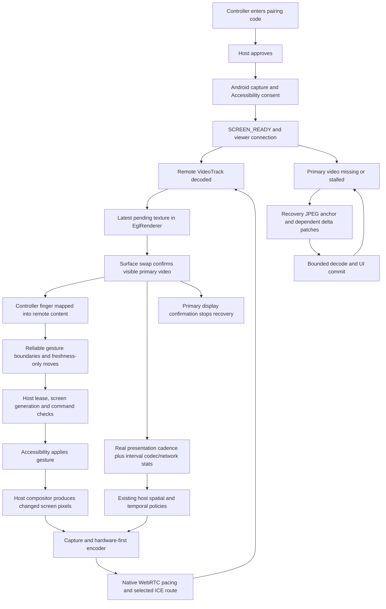

# Phone-to-phone screen streaming: architecture and change record

Scope: `warishakhan3548-hash/updating-repository`, inspected at
`6e692da3b99d926acd8add01d020aefe26145159`. This review covers the native
Android controller and host streaming path. The blueprint below was established
before implementation. Device performance still requires measurement.

## Dependency tree

```text
SessionCoordinator / SessionStateMachine / SessionRuntime
  host approval + Android Accessibility and MediaProjection consent
  ScreenShareService
    HostWebRtcSession
      ScreenCaptureTrack
        ScreenCapturerAndroid -> SurfaceTextureHelper -> VideoSource/VideoTrack
        CaptureProfile + StableCaptureGeometry: source/output pixel envelope
        CaptureRefreshPolicy: bounded idle and causal post-input texture pulls
        CaptureActivityTracker: natural source cadence and motion evidence
      WebRtcRuntime: shared EGL, hardware-first encoder/decoder factories
      WebRtcPeer: sender, native congestion control/RTP pacer, ICE/TURN, SCTP
      MotionVideoBudget: spatial relief and measured resolution recovery
      VideoCadenceGovernor: temporal operating point and bounded probes
      PhotonFreshnessGovernor: fresh evidence required for promotions
      CaptureQualityGovernor: longer-lived device/detail pressure
      FallbackScreenStreamer: bounded CPU-copy/JPEG/delta recovery only
  controller
    ControllerConnectionService / ControllerConnectionRuntime
      ControllerWebRtcSession -> remote VideoTrack
      InlineRemoteControllerView
        renderSink -> EglRenderer/EglThread -> SurfaceView -> Android compositor
        PresentationCadenceTracker -> receiver feedback -> host governors
        fallbackDecoder -> RecoveryBitmapRenderer -> ImageView
        RemoteViewportMapper -> GestureStreamPacer -> control packets
  reverse input
    WebRtcPeer control DataChannels -> host protocol/lease/geometry checks
    AssistAccessibilityService -> Android gesture -> changed host pixels
```

The Cloudflare backend owns pairing, signaling and TURN authorization, not
primary media encoding or presentation. AI/browser features are independent of
this native phone-to-phone change.

## Visual and state map



Decoded primary textures do not pass through the JPEG decoder or UI bitmap
queue. Displayed FPS, decoded FPS and source FPS are separate observations.
An ACK followed by a swap is a timing proxy, not causal proof that the input's
changed pixels are on screen.

## Confirmed intersection before implementation

`InlineRemoteControllerView.decodeFallbackFrameNow` decodes full JPEG anchors
on its serial executor, then posts each bitmap to the UI thread. Its compressed
pending-frame slot is bounded, but the executor continues draining after each
post. If the UI thread stalls, decoded full-size bitmaps and obsolete commits
can accumulate. The stale check before posting cannot bound that UI backlog.
This can consume memory and postpone fresh recovery pixels and input/UI work.

The surgical target is the ownership handoff between full-frame decode and UI
commit. It must bound both stages, preserve delta base-frame ordering, recycle
every discarded owned bitmap and remain safe across detach or primary-video
resumption. Primary RTP, user consent, command authorization and codec selection
retain their current owners.

STANDARD/HIGH already support above-720/native 1080-class source envelopes.
Increasing those limits alone would not establish better clarity or smoothness.
Further sender changes require independently verified live policy defects.

`VideoCadenceGovernor.observe` resets cached sender FPS and presentation-only
evidence when stream/codec identity changes, but leaves ordinary pressure,
healthy-recovery and interactive-headroom votes alive. It also lacks expiry of
those votes after a long completed-sample gap. `HighCadenceProbe` expires some
gap evidence but does not bind its candidate/trial evidence to sender identity.
The same host window can enter clarity or interactive paths without calling
ordinary `observe`, so a reset there alone cannot protect all decisions.

The second surgical target is evidence admission before any cadence decision:
bind votes to the current sender operating point (stream, MIME and concrete
encoder component when reported) and continuous completed
telemetry, invalidate old proof on replacement/discontinuity, and preserve the
learned cap plus overload/failed-trial cooldowns. This prevents unrelated old
and new windows from combining into a cadence change while keeping genuinely
consecutive evidence and immediate emergency relief authoritative.

`VideoHealthSnapshot.from` first correlates remote-inbound RTCP stats using
`localId == selected.id`, then falls back to any video-shaped remote report.
That fallback currently permits a report explicitly linked to a different,
retired sender. Its loss/RTT can therefore contaminate the current sender's
adaptation. The third target is the fallback predicate: explicit foreign
identities must be excluded, while vendor reports that genuinely omit
`localId` retain the compatibility fallback. Candidate-pair RTT remains the
existing fallback when no matching remote report supplies RTT.

Two capture-side defects were also reproduced using the actual policy sources:

- `CaptureQualityGovernor` uses mutually resetting recovery counters for quiet/
  ordinary healthy windows and populated healthy-bandwidth windows. Alternating
  one/two-frame idle windows, or clean `none`/`bandwidth` labels, never reach
  either threshold despite an uninterrupted accepted healthy sequence. Preserve
  the six-window ordinary and ten-window bandwidth/mixed thresholds while
  carrying accepted recovery progress across those branch changes. Pressure or
  ambiguous evidence must still discard the sequence.
- On Android before 12, a BALANCED 1080x2340 profile starts at 554x1200. A later
  FPS-only update recomputes the unchanged logical geometry as 552x1200 because
  initial rounding and update flooring differ. That unnecessarily invokes the
  legacy VirtualDisplay recreation path. Detect unchanged logical geometry
  before legacy rescaling; genuine rotation/display-size changes must still
  update, and Android 12+ retains adaptive producer resizing.

## Implemented behavior

| Owner | Result |
| --- | --- |
| Controller recovery admission | One full-frame decode/UI handoff remains in flight; the waiting full JPEG is replaceable. Dependent compressed deltas share the existing three-delta limit and wait for their own anchor's UI commit. Older deltas are submitted before the next anchor; replacing a pending anchor discards its orphaned chain. Failed/rejected work releases its bitmap/permit and retains bounded anchor recovery. |
| Sender cadence evidence | Stream, MIME, concrete component replacement or a completed-sample gap/reversed clock invalidates transient votes and probe proof before lane selection. Missing component labels on the same stream do not cause churn. The learned cap, overload cooldown and failed-target retry history survive. |
| Network telemetry correlation | Explicitly foreign remote-inbound identities are excluded. Matching reports win, genuinely missing identity metadata keeps the vendor fallback, and selected-route RTT remains available. |
| Capture clarity recovery | Six consecutive ordinary healthy windows or ten accepted healthy windows across mixed branches can recover one tier. Actual pressure/ambiguous evidence resets progress, and every recovery attempt starts fresh counters. |
| Legacy capture geometry | An unchanged logical display cannot trigger a producer resize solely through rounding/FPS changes. Real rotation and display-size changes still resize, and Android 12+ retains spatial relief. |

## Verification and limitations

Validation used Java 17, Gradle 9.6.0 and Android SDK 36 on the final frozen
source snapshot:

```sh
gradle :app:testDebugUnitTest -Pkotlin.incremental=false -Pkotlin.compiler.execution.strategy=in-process
gradle :app:lintDebug :app:lintRelease :app:assembleDebug :app:assembleRelease -Pkotlin.incremental=false -Pkotlin.compiler.execution.strategy=in-process
```

- All **712 unit tests passed**, with zero failures, errors or skipped tests.
- Debug and release lint completed with zero errors. Existing style/API warnings
  are still reported; this is not a warning-cleanup patch.
- Debug and release APK assembly passed. The release artifact is unsigned with
  this environment's absent signing inputs.
- Focused real-path recovery tests exercise paused UI delivery, anchor/delta
  order and chains, replacement, bounded admission, invalid decode, rejected
  handoffs, bitmap ownership and lifecycle cleanup. Sender/capture tests cover
  operating-point/gap fencing, retained cooldowns, emergency relief, RTCP identity,
  mixed healthy recovery and rounded legacy geometry. Independent review found
  no remaining blocking issue after the dependency-order correction.
- The complete embedded-patch auto-fixer passed clean-checkout preflight/apply,
  repeat-run no-op and exact patch replay checks. An overlapping local edit was
  rejected without modification. The script does not commit or push.

Local validation redirects test/tool caches to writable storage and forwards the
environment proxy/CA. Earlier interrupted/in-progress build results are not used
as evidence for the final snapshot.

No physical two-phone or connected-instrumentation run was performed. No local
automated check substitutes for two physical phones: compare
source/encoded/decoded/presented cadence, render-gap tails,
pixel dimensions, codec time, queue/jitter residence and thermal state on the
same content and route. Exercise scrolling, rotation, UI stalls, game animation,
direct Wi-Fi, TURN and bandwidth drop/recovery. Use a causal visual marker or
external camera for input-to-visible timing.

Live independent multi-finger gaming controls are not implied by clearer video:
the existing two-finger path submits a gesture after pointer release. Neither
zero latency nor zero dropped frames can be guaranteed across devices/networks.
