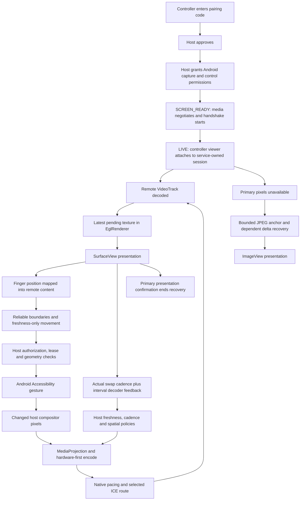

# Native screen sharing: architecture and smoothness audit

Scope: `warishakhan3548-hash/updating-repository`, Android host and native
Android controller. This blueprint was recorded before implementation. Backend
pairing/signaling, AI/browser features, authorization and user consent are outside
the change scope. Performance statements require physical-device measurements.

## Dependency tree

```text
MainActivity + SessionCoordinator + SessionStateMachine
  pairing -> host approval -> Accessibility + MediaProjection permission
  host: ScreenShareService owns the foreground capture lifetime
    HostWebRtcSession owns authenticated media/control and policy transitions
      CaptureProfile + StableCaptureGeometry: physical/output pixel envelopes
      ScreenCaptureTrack
        ScreenCapturerAndroid -> SurfaceTextureHelper (shared EGL)
        VideoSource.adaptOutputFormat -> VideoTrack
        CaptureActivityTracker + CaptureRefreshPolicy: supply/freshness evidence
      WebRtcRuntime + AarisRealtimeVideoEncoderFactory
        hardware-first encoder, bounded software fallback
      WebRtcPeer
        RtpSender -> native GCC/TWCC, RTP pacer -> selected ICE/STUN/TURN route
        authoritative ordered control + freshness-only unordered live control
        separate bounded compatibility-video DataChannel
      VideoHealthWindowTracker + ReceiverVideoFeedback
        source/encoder/queue/network/decoder/actual-presentation observations
      PhotonFreshnessGovernor: gates upward quality/cadence decisions
      VideoCadenceGovernor: source cadence; MotionVideoBudget: spatial budget
      CaptureQualityGovernor: device/tier relief and recovery
      FallbackScreenStreamer: same capture source, bounded JPEG/delta recovery
  controller: ControllerConnectionService owns transport independently of UI
    ControllerConnectionRuntime -> ControllerWebRtcSession -> remote VideoTrack
    AarisLowLatencyVideoDecoderFactory -> hardware-first decode
    InlineRemoteControllerView.renderSink -> EglRenderer -> SurfaceView
      Android compositor -> actual EGL presentation callback
      PresentationCadenceTracker -> lease/generation-bound receiver feedback
      fallback decoder -> RecoveryBitmapRenderer -> ImageView (recovery only)
      RemoteViewportMapper + GestureStreamPacer -> authenticated control packets
  reverse control: WebRtcPeer -> CommandGate -> AssistAccessibilityService
    serialized/coalesced Android gestures -> changed host screen pixels
```

Cloudflare is the session/signaling/TURN authorization plane; primary pixels do
not pass through a Worker. The existing STANDARD profile supports a native
1080x2400-class screen with a 25 Mbps ceiling; HIGH supports a 2560-pixel long
edge and a 32 Mbps ceiling. These are maxima, not guaranteed transmitted quality.
Constrained devices and paths must retain safe adaptive relief below these
profiles. The session maximum is 60 FPS, subject to real source/codec capacity.

## Visual and state map



The controller viewer uses a black, immersive full-screen root. Remote content
is aspect-fitted into the available area rather than stretched; mismatched
aspect ratios leave black bars. A side dock reserves space while visible, then
collapses to an edge handle so remote navigation remains reachable. Touch
coordinates use the same fitted-content rectangle; a new gesture in a black
bar is rejected and an existing drag can clamp to the remote content edge.
Portrait/landscape follows remote geometry. Recovery JPEGs occupy the same
fitted area until actual primary presentation confirms that recovery can hide.
Closing the viewer detaches its surface; the foreground connection service
continues owning the session.

## Intervention rules

- Preserve the native texture-to-EGL path and latest-frame ownership; do not add
  another media queue, bitmap conversion, synthetic frames or custom RTP pacing.
- Diagnose actual source, encoder, transport, decoder and presentation evidence
  separately. Requested FPS is not delivered FPS; decoded FPS is not display FPS.
- Modify the existing policy or ownership boundary responsible for a reproduced
  problem. Bind adaptation proof to its operating point and to fresh evidence.
- Keep gestures and their safety/consent checks on their existing owners.
- Treat command ACK-to-next-swap timing as a proxy, not causal input-to-photon
  measurement. Do not infer gaming latency from that proxy alone.

## Verification boundary

Automated policy/lifecycle tests and Android build checks can establish bounded
state transitions and regression coverage. They cannot establish zero stutter,
an always-above-720p stream, or local-device gaming latency. Compare the baseline
and changed APKs on the same two physical phones under direct Wi-Fi, cellular
and TURN, including motion without touch, rapid taps, scrolling, rotation and a
moving game. Record source/encoded/decoded/presented cadence, frame-gap p95/max,
freezes, queue residence, actual/target jitter delay, codec cost, QP, dimensions,
thermal state and causally measured input-to-visible latency.

## Confirmed surgical target: touch-clock quantization

`InlineRemoteControllerView.streamSingleGestureIfNeeded` attempts CONTINUE
transmission only when Android supplies a MOVE event. The original
`GestureStreamPacer.onSent` placed the next deadline at the actual event time
plus 16 ms. A late eligible event consequently shifted every subsequent
deadline. At a 90 Hz event clock, a 16 ms wait rounds up to two events every
time, admitting only about 45 updates per second even without backpressure.
At 144 Hz the same pattern admits roughly 48 updates per second. A healthy
120 Hz source happens to mask this mismatch.

The intervention belongs in the original pacer deadline, not the video
renderer or an additional timer/queue. Preserve phase during a healthy,
continuously supplied event sequence, submit at most one current update per
event, and discard scheduling debt after a stall. Transport backpressure must
retain an actual-time cooldown; reliable START/END boundaries bypass pacing.
The configured 16 ms period is a 60 Hz-class input target, not a promise of
exactly 60 updates, 60 unique video frames or a lower network RTT.

## Gaming interaction limits

The native controller uses Android Accessibility gestures rather than a local
game input driver. Discrete taps and two-finger gestures have release-time
semantics; a stationary live drag can hit the host's continued-stroke watchdog.
These are independent input-model limitations, not evidence of a video freeze.
Do not advertise full local-device competitive-game behavior based on a video
pipeline or touch-pacing change. A future input-model change needs separate
hold, cancellation, disconnect, authorization and multi-pointer validation.

## Spatial-policy operating-point boundary

`VideoHealthWindowTracker` correctly reseeds interval counters when the concrete
encoder component changes without an RTP stream or MIME change.
`VideoCadenceGovernor.onSenderEvidence` likewise invalidates its transient proof
before the host chooses a policy lane. In contrast, the original
`MotionVideoBudget.observe` resets spatial pressure/recovery/residence history
only for a stream/MIME change or an elapsed evidence gap. Its separate
`lastImplementation` update recognizes a new hardware encoder but leaves those
votes alive. `HostWebRtcSession.onVideoHealth` also returns on an incomplete
window before calling the spatial observer.

The intersection is evidence admission, not media transport: a pressure vote
from one encoder must not combine with a vote from its replacement to justify a
source resize. Component identity must be checked before the completed-window
guard and before cadence/spatial lane selection. Missing component labels on the
same stream are not a replacement. Committed source detail and relief/recovery
cooldowns remain valid; transient proof must be earned on the current encoder.

The new regression was first compiled against the original policy and failed:
at a native 720-pixel short edge, encoder A contributes a 20 FPS/35 ms pressure
window; encoder B then contributes one equivalent window on the same RTP/MIME.
The old code combines them and resizes to 540 pixels. After identity fencing,
the first B window must leave 720 pixels intact; only another qualifying B
window can earn the existing ordinary two-window relief.

## Implemented changes and focused evidence

- The original touch pacer retains its deadline phase for timely healthy
  events. Backpressure starts a full actual-time cooldown; missed periods are
  discarded after a stall. No event replay, timer, queue or video-path change
  is introduced. The 13 pacer tests pass through Android Gradle compilation.
  Ten-second deterministic event sequences admit 600/625/625/625 updates at
  60/90/120/144 Hz, respectively, compared with 450 and 480 for the original
  90/144 Hz cases. This is a scheduling result, not measured phone latency.
- The existing spatial budget now admits stream/MIME/concrete-component
  boundaries before host early returns or cadence-only decisions. Proven
  replacement clears pressure, healthy/fast-recovery and residence-growth
  history while keeping committed geometry and safety cooldowns. Ten new
  boundary tests and 185 focused policy tests pass. Identity retention across
  missing labels never substitutes for freshly reported implementation
  evidence when authorizing native-detail recovery.
- Capture profiles, encoder bitrate ceilings, native WebRTC congestion control,
  primary renderer and authorization/consent retain their existing behavior.

## Complete guarded auto-fixer

`tools/apply_native_screen_smoothness.py` embeds the full production/test patch;
it does not depend on an external patch download. From a repository root:

```sh
python3 tools/apply_native_screen_smoothness.py --check
python3 tools/apply_native_screen_smoothness.py
```

A downloaded standalone copy accepts `--root /path/to/updating-repository`.
It verifies exact before/after Git blob hashes, rejects changed or symlinked
sources before applying, skips already-fixed files and uses one checked Git
apply operation. It does not commit, publish, change branches or access the
network. Source versions other than the audited baseline are refused.

The script was tested against a clean clone: check-only produced no changes;
application produced the expected five source/test files; a second application
was a verified no-op. A deliberately edited source was refused and the full
working diff remained byte-for-byte unchanged. The current fixed tree also
passes script preflight.

## Reproducible Android validation

Toolchain: Temurin JDK 17, Gradle 9.6.0 and Android API 36, matching the
repository's CI configuration. No build configuration or app version was
changed. The original baseline passed 726 unit tests and both lint/APK variants.
The edited tree passes 745 unit tests with no failures, errors or skips,
including 19 added regressions. Production Kotlin compilation passes for debug
and release. The full edited-tree command below completed successfully: debug
and release lint each report zero errors and the same 105 warning identities
as the baseline, with no new warnings; debug and unsigned release APKs both
assembled successfully.

```sh
gradle :app:testDebugUnitTest :app:lintDebug :app:lintRelease \
  :app:assembleDebug :app:assembleRelease --stacktrace
```

APK assembly is not signed-release publication or installation on either phone.
The native Android emulator loopback and two-physical-phone performance matrix
were not executed in this session. The script round-trip checks and deterministic
policy tests do not replace those device measurements.
