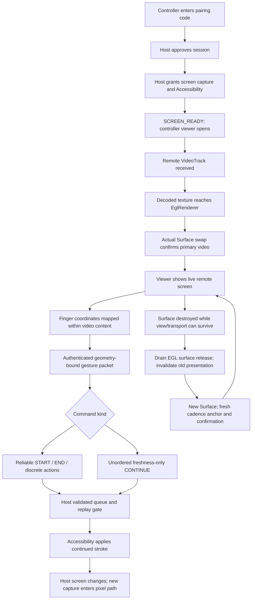

# Screen sharing: dependency map, state flow and targeted corrections

Inspected baseline: `0b3eef5c1e2b7099e686c8d53e71aa0ea222871b` in
`warishakhan3548-hash/updating-repository`. This audit concerns the native
phone-to-phone screen/control path. Code analysis and automated tests are not
measurements of physical phone smoothness.

## Code skeleton

```text
app/
  session/       SessionCoordinator / SessionStateMachine / SessionRuntime
  pairing/       Host approval, one-time pairing and session authority client
  capture/       ScreenShareService -> HostWebRtcSession -> ScreenCaptureTrack
                 CaptureProfile / CaptureQualityGovernor / StableCaptureGeometry
  webrtc/        WebRtcRuntime -> shared EGL + encoder/decoder factories
                 HostWebRtcSession -> WebRtcPeer -> RTP / SCTP / ICE
                 ControllerConnectionService / ControllerConnectionRuntime
                   -> ControllerWebRtcSession -> remote VideoTrack
                 MotionVideoBudget / VideoCadenceGovernor / PhotonFreshnessGovernor
                 ReceiverVideoFeedback / PresentationCadenceTracker
  ui/            MainActivity -> InlineRemoteControllerView
                 RemoteViewportMapper / GestureStreamPacer
  control/       ControlProtocol -> CoordinateMapper -> CommandGate
  accessibility/ AssistAccessibilityService -> Android continued gestures
  diagnostics/   Existing connection and video health reporting
  ai/            Separate AI/browser control features, outside this patch
  src/test/      Unit and Robolectric regressions
  src/androidTest/ Native WebRTC pixel/control loopback
cloudflare/      Pairing, signaling, TURN authorization and browser compatibility
docs/            Architecture and device-validation notes
tools/           Reproducible diagnostics and patch utilities
```

Package names above are relative to `app/src/main/java/com/aaris/remoteassist/`.
The custom MediaCodec factories live in `app/src/main/java/org/webrtc/`.

## Pixels and feedback

```mermaid
flowchart LR
    Screen[Host Android compositor] --> Projection[Consented MediaProjection]
    Projection --> Capture[ScreenCapturerAndroid / SurfaceTextureHelper]
    Capture --> Source[VideoSource / VideoTrack]
    Source --> Encoder[Hardware-first codec, software fallback]
    Encoder --> RTP[Native WebRTC congestion control and RTP pacer]
    RTP --> Route{Selected ICE route}
    Route --> Direct[Direct peer path]
    Route --> Relay[TURN relay]
    Direct --> Receiver[Native reorder / repair / jitter timing / decoder]
    Relay --> Receiver
    Receiver --> Sink[Controller VideoTrack renderSink]
    Sink --> EGL[EglRenderer, latest pending frame wins]
    EGL --> Surface[Controller Surface / Android compositor]
    Surface --> Feedback[Swap cadence and bounded feedback]
    Feedback --> Policy[Host pixel / cadence / freshness policies]
    Policy --> Source
    Policy --> Encoder
```



Normal primary video stays texture-backed. It does not travel through Worker
JPEG uploads, an application decoded-frame reservoir or a main-thread frame
clock. Capture forwards to the primary observer before optional snapshot sinks.
The current source is classified as screencast; older realtime-mode documents
must not be used to infer a different native classification at this baseline.
The pinned native playout hint is 20–180 ms, best-effort rather than a guarantee.

Only genuine completed capture/encode/receive/presentation windows can justify
upgrades. Average decoded FPS does not prove timely presentation. ACK followed
by a swap is an existing latency proxy, not proof that the input's changed
pixels have appeared. Source, codec, network and glass remain distinct evidence.

## UI and state map



Viewport mapping preserves aspect ratio and rejects touches outside content;
display generation and live lease bind controls to the authorized screen.
STOP, lock-screen and sensitive-field gates stay authoritative at execution.

## Surgical targets and ripple effects

| Target | Verified defect | Correction and downstream effect |
| --- | --- | --- |
| `MotionVideoBudget.observe` recovery | Recovery ends at a 720-pixel short edge even when the active profile permits native 1080-class detail. Continuous motion never releases that clamp. | Add a profile-bounded native recovery step after the existing readable rungs. Require projected bitrate and encode/decode cost, actual frame geometry and presentation proof; retain touch/trial and pressure gates. The existing host policy application updates sender/source in its established order. |
| `MotionVideoBudget` BWE prediction | Its independent 85% utilization trigger contradicts the existing 1.10 headroom contract, downscaling clean streams that the cadence policy accepts. | Derive the predictive threshold from that same contract. Real encoder, queue, loss, receiver and presentation pressure retain their separate authority. |
| `AssistAccessibilityService` pending gestures | An older unordered CONTINUE can evict a newer queued position before authorization/replay validation. A mismatched stream can also cancel the active gesture watchdog. | Coalesce by authorized identity and increasing sequence; retain authoritative boundaries and execution-time checks. Cancel the watchdog only for a validated matching operation. Actual input application and discarded work have distinct completion semantics. |
| `InlineRemoteControllerView` Surface lifetime | Asynchronous EGL release returns before Android destroys the Surface. Old queued presentation evidence survives recreation. | Honor the native release-completion contract and reset/fence presentation state at the Surface boundary. Prevent obsolete swaps and intentional pauses from becoming current glass proof or false congestion signals. |

These changes repair existing owners rather than adding another adaptive
controller, frame queue, encoder override or network pacing layer.

## Quality and control limits

STANDARD/HIGH profiles already permit native 1080-class capture when the source,
device and path support it; this patch repairs recovery to that permitted
quality. It does not upscale a small physical source or force an unsustainable
resolution during congestion. LOW/BALANCED, software codec fallback, thermal
pressure and limited bandwidth can still require less detail or cadence.

Single-finger drag uses live continued strokes. Existing two-finger handling
collects endpoints and submits the gesture on pointer release; it is not live
independent simultaneous joystick/aim/fire input. This patch does not claim
native-phone competitive-game control parity or zero latency. Stationary taps
also submit on release; a live single-finger stream begins only after motion
exceeds touch slop.

The Surface release barrier follows the pinned WebRTC family's existing
[SurfaceEglRenderer lifecycle](https://github.com/webrtc-sdk/webrtc/blob/m150_release/sdk/android/api/org/webrtc/SurfaceEglRenderer.java):
`releaseEglSurface` is asynchronous, so Android's destruction callback waits for
its EGL-lane completion. It does not add a steady-state frame synchronization
stage.

## Validation gate

Automated checks must cover above-720 recovery and denied upgrades, healthy BWE
reserve boundaries versus real pressure, out-of-order/unauthorized gesture
coalescing, watchdog ownership, and Surface callback/lifetime fencing. Existing
unit, Robolectric, lint and assembly checks provide regression evidence; native
loopback and physical-device tests must be reported separately.

Before declaring a user-visible performance improvement, compare baseline and
patched builds on the same two phones during scrolling, rotation, background /
foreground and continuously moving content. Include direct Wi-Fi and mobile /
TURN paths and an induced bandwidth dip followed by recovery. Record unique
source/encoded/decoded/presented FPS, frame-gap p95/p99/max, freezes, sent pixel
dimensions, encoder/decoder time, RTP queue residence, loss/RTT, actual jitter
residence and thermal state. Use a causal visual marker or external camera for
input-to-visible timing. More detail must not hide increased stale-video delay.

Remaining audit observations, outside these corrections: source-gap telemetry
excludes every first frame in a sampling window (which can hide a hitch across
the boundary), unchanged-profile first-capture retry does not itself actuate
capture, and JPEG fallback's decoded full-frame UI commits deserve a separate
bounded-backlog review. These are not claimed fixed by this patch.
