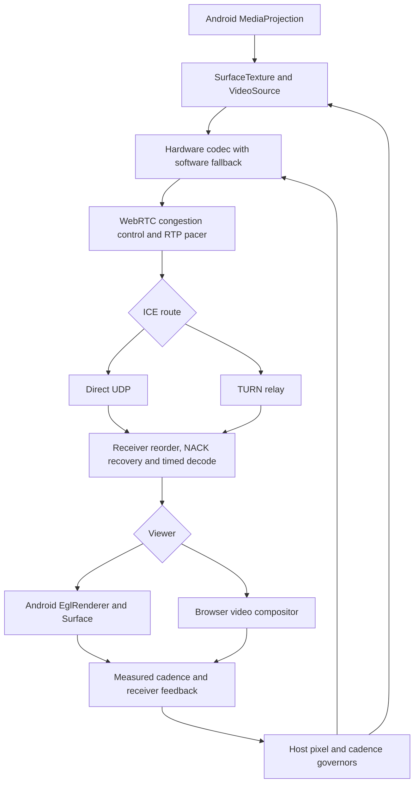

# Video path and responsive smoothing

Baseline inspected: `dc5b7b79f850622f60baf15fed3ffe4b6b045232` (PR #548).
The user's selected priority is responsive control, with adaptive smoothing,
not a mandatory one-second delay. This change is version 1.9.56 (144).

## Where pixels actually travel

| Stage | Code and behavior | Relevant measurement |
| --- | --- | --- |
| Capture | `capture/ScreenCaptureTrack.kt`: MediaProjection → SurfaceTextureHelper → native VideoSource. Main video is submitted before auxiliary snapshot sinks; natural frames are not CPU-converted. | Source FPS; capture geometry |
| Encode | `webrtc/WebRtcRuntime.kt`: shared EGL context, hardware codec factories with software fallback; H264/VP8 capability selection. | Encode service time, output FPS, codec implementation |
| Send | `webrtc/WebRtcPeer.kt`: native GCC/TWCC rate control, RTP packet pacing and negotiated recovery. | Available outgoing bitrate, send-queue residence, packet loss |
| Network | Signaling establishes the session and ICE route. Primary video travels via the selected direct/TURN WebRTC route. Cloudflare session APIs and JPEG fallback are separate paths. | Selected candidate path and RTT |
| Receive | Native libwebrtc reorders packets, requests eligible missing packets, assembles decodable frames and schedules decode against RTP timing. Browser exposes a preferred receiver target; Android Java has no public minimum-delay setter in the pinned dependency. | Interval jitter-buffer actual/target/minimum delays, decode service time, freezes |
| Present | `ui/InlineRemoteControllerView.kt`: decoded frames go straight to EglRenderer, with one replaceable pending frame. Browser uses the native video compositor. | EGL swap cadence or browser compositor callback cadence, maximum observed gap |
| Adapt | `HostWebRtcSession.kt`: MotionVideoBudget owns motion pixel relief; VideoCadenceGovernor owns cadence; PhotonFreshnessGovernor gates upgrades; CaptureQualityGovernor handles its existing detail/local-pressure path. There is no UnifiedMediaController class on this baseline. | Fresh receiver windows, source supply, encoder/pacer pressure, presentation evidence, thermal state |
| Input | Reliable control commands/ACKs and a separate freshness-oriented live gesture channel. Input never waits behind the video reservoir. | Command ACK time and post-ACK next-swap proxy |

## What changed and why

1. **Native scheduling:** replace the global RTP hint `min=0,max=100` with
   `min=10,max=500`. In the pinned M150 implementation, `min=0,max<=500`
   selects the render-as-soon-as-possible path (`RenderTime=0`). A positive
   minimum permits native timestamp scheduling, while 500 ms is a best-effort
   ceiling for recovery, not a constant hold. It also removes the conflict
   between the old 100 ms sender maximum and browser targets up to 500 ms.
   No Java/Kotlin decoded-frame reservoir or custom frame synthesis is added.
2. **Responsive browser reservoir:** start at 100 ms. The ladder is
   100 → 150 → 250 → 350 → 500 ms. Increase one rung only with measured network
   floor close to the requested target, working decoder and no large excess
   queue. Require repeated evidence (or a corroborated freeze) and a 4 s hold.
   Drops alone, slow decoding, idle content and unavailable stats cannot raise it.
   Lower one rung after 30 continuous measured clean seconds; hidden time and
   missing samples do not count as recovery.
3. **Honest pressure:** receiver feedback subtracts only the application's
   accepted preference, capped by a lower measured target. It never subtracts
   an arbitrarily inflated native target. Example: actual=720, native target=700,
   app target=250 now reports **470 ms** pressure, instead of hiding it as 20 ms.
   A target chosen for the next interval cannot erase pressure from the old one.
   A planned downshift retains at most the old allowance for two seconds while
   it drains; newly growing delay above that budget remains visible immediately.
4. **Presentation feedback:** browser compositor windows now reach the existing
   host cadence governor, rather than reporting decoder FPS alone. Missing JS
   callbacks are detected with the compositor's frame counter; incomplete gap
   evidence is omitted rather than inventing freezes. `timeupdate` is never
   used to manufacture cadence samples.
5. **Sampling correctness:** browser stats are single-flight, receiver-specific,
   fenced across connection/track/visibility changes, and computed from current
   interval deltas. Missing counters stay unknown; resets reseed the sample.
6. **Latency terminology:** ACK followed by the next EGL swap is only a proxy.
   That swap may contain an older buffered frame. Diagnostic labels no longer
   advertise it as an input-to-photon upper bound; wire fields remain compatible.

## What a buffer can and cannot do

Packets can arrive out of order; frames must still be presented in media-time
order. Native timing and retransmission deadlines use the available recovery
window before a frame is due. Retransmission is bounded by RTT, sender packet
history, decoder dependencies and bandwidth; it is not guaranteed to succeed.
Sustained under-capacity or codec overload must still reduce the workload.

Native Android uses adaptive libwebrtc timing within the sender's best-effort
hint. It does **not** acquire the browser's explicit target ladder. Updating the
Android sender is necessary to change its RTP hint; a Worker-only update cannot
alter an already-installed APK. No setting can guarantee 60 unique FPS, an exact
delay, or uninterrupted playback on every network/device.

## Validation and remaining device gate

Automated tests cover pressure masking, stalled/overloaded/idle receivers,
missing/reset counters, bounded target growth, clean-time hysteresis, compositor
gaps and callback loss. The Chromium integration test runs actual RTP/SCTP between
two synthetic peers and verifies input plus decoded/presented feedback. Android
CI runs the existing unit, smoothness-model, lint and debug/release build jobs.
The smoothness model is not a physical phone or native jitter-buffer benchmark.

Before claiming improved phone-to-phone smoothness, compare baseline and this
build on the same two devices for at least 10 minutes: direct Wi-Fi, mobile/TURN,
scrolling, rotation and a moving game. Collect source/encoded/decoded/presented
FPS, render gap p95/max, freeze events, actual/target jitter residence, encoder
and decoder cost, sender queue, thermal state, and true action-to-visible timing
using a frame marker or external camera. Check that lower delay is not purchased
with extra freezes and that recovery returns to a small buffer. Signed release
and deployed Worker status must be reported separately from passing CI.

## Source checks

- Pinned SDK: `io.github.webrtc-sdk:android:150.7871.01`, matching
  [webrtc-sdk/webrtc commit 73cb818](https://github.com/webrtc-sdk/webrtc/tree/73cb8180f7258ee292878d6edd05177f41883962).
- [M150 timing implementation](https://github.com/webrtc-sdk/webrtc/blob/73cb8180f7258ee292878d6edd05177f41883962/modules/video_coding/timing/timing.cc)
  and [RTP hint parsing](https://github.com/webrtc-sdk/webrtc/blob/73cb8180f7258ee292878d6edd05177f41883962/modules/rtp_rtcp/source/rtp_sender_video.cc).
- [WebRTC playout-delay extension](https://webrtc.googlesource.com/src/+/refs/heads/main/docs/native-code/rtp-hdrext/playout-delay/README.md): limits are best-effort guidance.
- [W3C jitterBufferTarget](https://www.w3.org/TR/webrtc/#dom-rtcrtpreceiver-jitterbuffertarget): application preference, not a fixed stopwatch delay.

## Follow-up: native overuse relief and stable stats windows (October 2026)

Two additional problems were located after PR #549:

- `VideoHealthWindowTracker` advanced its baseline on invalid, sub-500 ms
  samples. Early 500 ms polls or the intentional fast 100/120 ms probes could
  repeatedly erase the deltas required by the motion/cadence governors. These
  samples now accumulate until a valid 500–6000 ms window. Counter resets,
  codec/stream changes and timestamp discontinuities still reseed safely.
- The sender was configured with `MAINTAIN_FRAMERATE_AND_RESOLUTION`. This
  prevented native encoder spatial relief while the app waited for multi-window
  feedback. It now uses `MAINTAIN_FRAMERATE`: libwebrtc can lower spatial
  workload inside the application-defined maximum source envelope to preserve
  motion cadence under codec/transport stress.

This is a code-level optimization, not a claim of measured smoothness. Compare
against the parent build on two physical Android devices for 10 minutes each
under Wi-Fi, poor network, TURN, scrolling and gaming. Record actual source,
encoded, decoded and presented FPS, max frame gap, codec service time, encoder
frame dimensions, send queue and receiver jitter residence. Check especially
for resolution oscillation or hardware codec reinitialization. No guarantee
of 60 unique FPS is possible when capture or bandwidth cannot supply it.

## Controller display-clock stabilization (October 2026)

Scope: **Android controller Surface scheduling**, not sender RTP or buffering.
The native controller's `SurfaceFrameRateHintGovernor` was using measured
*video* FPS (15/20/24/30/45/60) as a target *physical display* hint, then
overriding that hint to 60 at every finger-down and restoring the lower
measured rate on every finger-up. Measured decode/presentation FPS is a
congestion/producer outcome; it is not a safe representation of display
hardware capacity. Repeated `Surface.setFrameRate` votes may cause display
refresh transitions and may compound judder during rapid gestures on some
Android devices. This is a **code-level scheduling risk**, not proof that
it caused the observed 2 fps bandwidth-limited sessions.

The controller now makes **one 60 Hz-class best-effort Surface vote per
video stream**, either after three clean EGL presentation windows or at
the first remote gesture. It does not vote down to the fluctuating network
video FPS and does not clear/reapply the preference on every finger-up.
An explicitly lower caller ceiling is respected. Existing video-stop/track
replacement and recovery lifecycle resets clear the vote; Surface lifecycle
recreation reapplies the retained vote. `CHANGE_FRAME_RATE_ONLY_IF_SEAMLESS`
continues to be used where Android supports it. No frame duplication,
interpolation, extra media queue, altered encoder bitrate, network transport
or playout buffering is introduced.

Unit tests cover clean-start requirements, passive 24 fps streaming,
repeated tap/swipe transitions, frozen/stalled windows, bounded caller
ceiling and stream reset. The patch still requires physical validation:
capture Android controller display refresh/mode transitions and EGL
presentation-gap p95/max during ten-minute touch/scroll/video/game
sessions; compare against the preceding build on identical phones and
network, including power/thermal effects. If the measured stutter remains
while source/encoded FPS is low, investigate host codec, source adaptation,
network bitrate and selected ICE route before increasing jitter buffering.

## Governor continuity across incomplete stats probes (October 2026)

The host `WebRtcPeer` requests one-shot video-health samples 100/120 ms
after motion/reconfiguration. `VideoHealthWindowTracker` intentionally does
not generate an interval window before 500 ms, to avoid misleading FPS. In
`MotionVideoBudget.observe`, a missing `outbound.recent` previously erased
`pressureSamples`, `healthySamples`, and rising queue-residence history.
The regular completed encoder/receiver windows could therefore struggle to
meet two-sample hysteresis whenever early probes interleaved them.

A missing or incomplete sender interval now makes **no policy observation**
and leaves the existing pressure evidence intact. If the next completed
sender interval arrives more than six seconds after the previous completed
one, the stale evidence expires before that interval is evaluated. A changed
RTP stream identifier or codec also clears the previous stream's pressure
state immediately, including when the first replacement probe is incomplete.
Actual non-motion observations still clear the motion state as before.
Regression tests exercise a complete overload interval, an incomplete 120 ms
probe, a second overload interval, long-gap expiry and stream/codec replacement.
This changes neither capture/codec/pacer behavior nor media buffering;
it fixes when the existing resolution governor decides to act. Hardware
device smoothness remains unmeasured.
